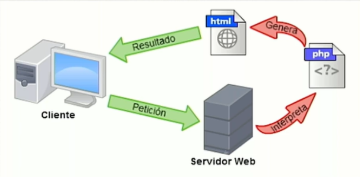
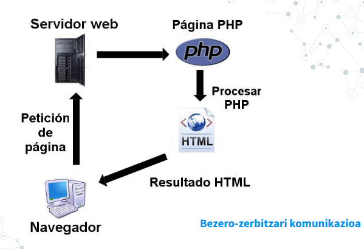

# Web programazioaren ezaugarriak

Web orri bat deskargatzen dugunean, haren edukiak zehazten du pantailan agertuko dena (HTML).  

Ondo egituratua badago, estilo-orria (CSS) izango du, orriaren atal bakoitzaren estiloa nabigatzaileari adierazteko.  

**Bezero–zerbitzari komunikazioa** deitzen zaio, non bezeroak (nabigatzailea) eskaera (**request**) bidaltzen duen eta zerbitzariak erantzun (**response**) bueltatzen duen.

