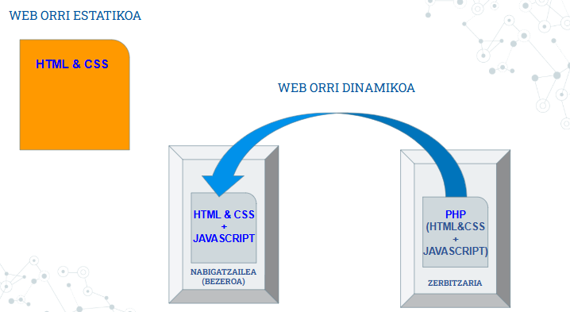

# Web-orria estatikoa vs dinamikoa

## Estatikoki sortutako orriak
- Eduki finkoa dute; sortu ziren moduan gordeta daude.  
- Aldaketak eskuz egin behar dira (HTML/CSS zuzenean aldatuz), kodea aldatu behar da aldaketak lortzeko  
- Beti informazio bera erakutsiko dute, bezeroek ez dute orria aldatzen.

## Dinamikoak
- Edukia hainbat faktoreren arabera alda daiteke (nabigatzailea, erabiltzaile identifikatua, formulario-sarrera…).  
- Zerbitzarian exekutatutako programa batek sortutako HTML bidaltzen da php, asp, python etab.  
- Azken erabiltzaileak ez du jatorrizko kodea editatu beharrik.

### Abantailak eta eragozpenak
- **Estatikoak**  
  \+ Sinpleak eta azkarrak.  
  – Eskuz eguneratu behar dira, mantentze lanak zailagoak dira webgune handietan.
- **Dinamikoak**  
  \+ Edukia aldakorra eta pertsonalizagarria.  
  – Zerbitzari baliabide gehiago behar dituzte eta segurtasun neurrien beharra dago. 

*Diagrama honek erakusten du Web dinamikoa eta estatikoa artean nola zerbitzari dinamikoak datu-basearekin elkarreragiten duen HTML eraikitzeko.*
