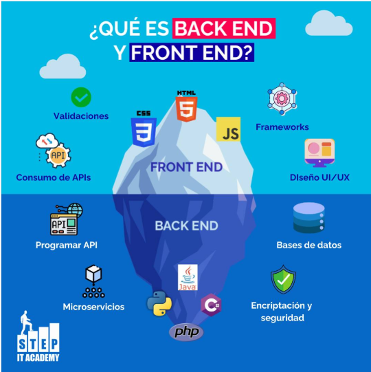
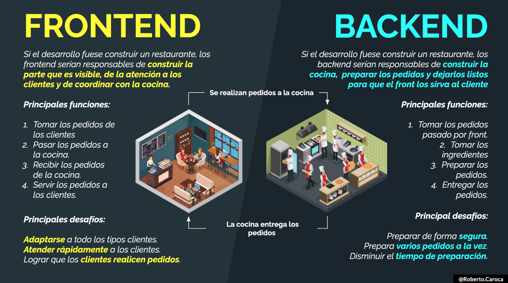

# Web aplikazioak

Web aplikazioek bi alderdiri ematen diete bidea:

## Front-end (kanpoko aldea)
- Plataformaren ageriko zatia, bezeroarekin interakzioa.  
- Erabiltzaileak nabigatzean ikusten duen diseinua, efektuak, formularioak…  
- Teknologiak: HTML, CSS, JavaScript.

## Back-end (barneko aldea)
- Zerbitzariko logika: eskaerak jaso, datu-basearekin elkarrizketa, negozio arauak aplikatu.  
- Erabilitako lengoaia/teknologia: PHP, Python, Java, ASP…  
- Jatorrizko “nukleo” hori exekutatzen du zerbitzariak. 

*Diagrama honek erakusten du Front-end eta Back-end artean nola zerbitzari dinamikoak datu-basearekin elkarreragiten duen HTML eraikitzeko.*

