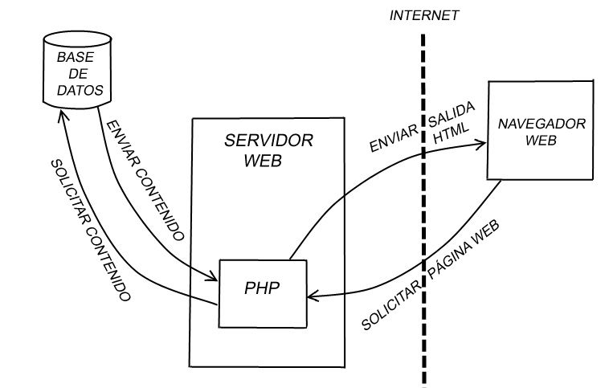

# Zerbitzarian web programazioa burutzeko teknologiak

Web aplikazioak exekutatzeko beharrezko osagai nagusiak:

- **Web zerbitzaria**  
  HTTP eskaerak jasotzea eta erantzunak bidaltzea, bai fitxategi estatikoak (HTML, CSS, JS) bai aplikazio-prozesu baten emaitzak (PHP script-ak). Adibidez, Apache edo Nginx.
- **Kodea exekutatzen duen inguru**  
  Zerbitzarian gara­tutako script-ak (PHP, Python, Java…) exekutatzen ditu eta HTML sortzen du.
- **Datu-basea**  
  Datuak gordetzeko eta eskuratzeko aplikazioa (MySQL, MariaDB, PostgreSQL…).
- **Programazio lengoaia**  
  Web aplikazioa garatzeko erabiltzen den teknologia (PHP, Python, Java…).
  

  

