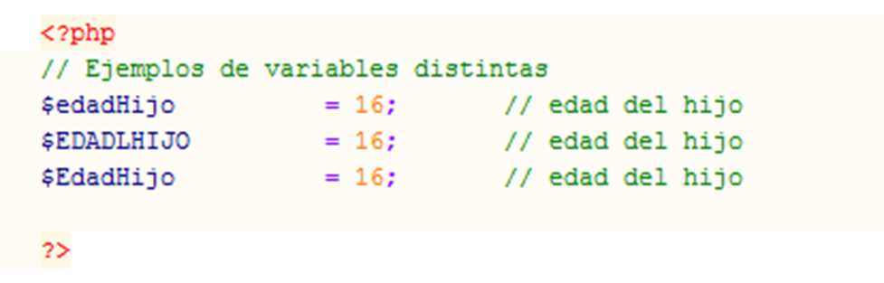
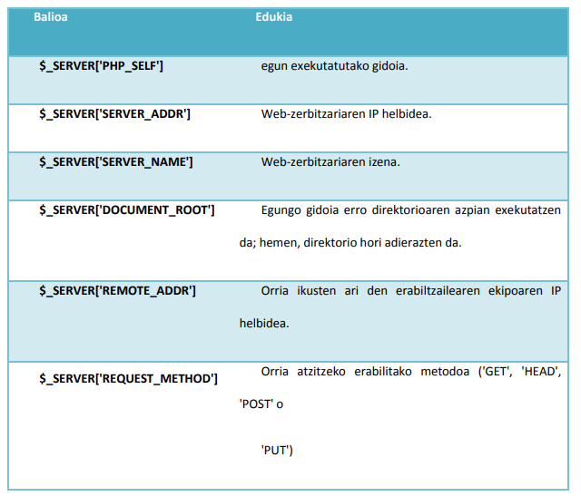
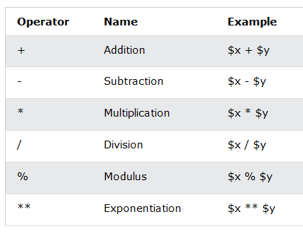
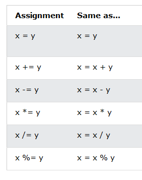
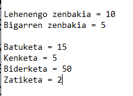
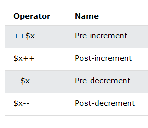
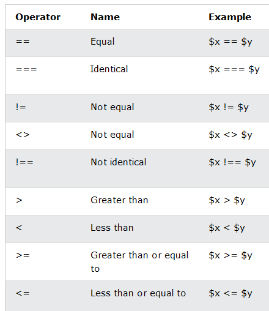
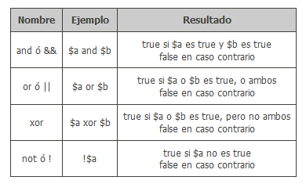

# DWS 2. unitatea Aldagaiak eta adierazpenak


## Web programazioa PHPrekin
 
### Hasiera

PHP web-orri dinamikoak egiteko diseinatuta

```php
<?php
// …
?>
```

Konfigurazioa `http.conf` eta `php.ini` fitxategietan egiten da  
`php.ini`-n erabili daitezkeen direktiben zerrenda dago PHPren dokumentazioan:  
<http://php.net/manual/es/ini.core.php>

### Iruzkinak
Oso gomendagarria (ez dira ikusiko, HTMLkoak bai)

```php
// Lerro bakarrekoa
/*  …….  */    Lerro bat baino gehiago
```


## Aldagaiak eta datu-motak
- Aurrean $ zeinua egongo da beti.
- Aldagaien izenak letrez hasi behar dira eta gainerako karaktereak letrak, zenbakiak edo gidoi baxua (_) izango dira.
- Ez da derrigorrezkoa aldagaiak deklaratzea.
- Ez da datu-mota zehaztu behar.
- Nahikoa da balio bat ematearekin.

```php
$nire_aldagaia = 7;
```

- Emandako balioaren arabera aldagaiari datu mota bat esleituko zaio.
- Aldagaien izenak letra txikiaz
- PHPk letra txikia eta letra larria ezberdintzen ditu:




- **Boolearra (boolean):** Egia (`true`) eta gezurra (`false`) dira haren balio posibleak; gainera, edozein zenbaki oso egitzat hartzen da, 0 izan ezik.  
- **Osoa (integer):** Hamartarrik gabeko edozein zenbaki. Hamartarrean, bitarrean, zortzitarrean edo hamaseitarrean adierazi daitezke.  
- **Erreala (float):** Edozein zenbaki hamartar, notazio zientifikoan ere adierazi daitezke.  
- **Katea (string):** Kakotx sinple edo bikoitzek mugatutako karaktere-multzoa.  
- **Null:** Datu mota berezia; aldagaia baliorik gabekoa dela adierazten du.  


- Mota ezberdinetako aldagaiekin eragiketa bat egiten baldin bada, guztiak mota komunera bihurtuko dira:
```php
    $nire_osokoa = 3;
    $nire_erreala = 2.3;
    $emaitza = $nire_osokoa + $nire-erreala;
    // $emaitza aldagaia erreal motakoa da.
```
Bihurketak behartu egin daitezke:
```php
    $nire_osokoa = 3;
    $nire_erreala = 2.3;
    $emaitza = $nire_osokoa + (int) $nire_erreala;
    // $nire_erreala aldagaia osoko bihurtzen da (2 baliora) batu baino lehen.
    // $emaitza aldagaia osokoa da (5 balioa izango du).
```

## Ariketekin hasi aurretik…..
### Echo
Mezuak pantailan idazteko agindua da.
```php
echo "<p>Hau da erakutsiko dugun mezua.</p>";
```
Aldagai bat erakutsi ahal izateko:

```php
    echo "<p>X aldagaiaren balioa  $x da.</p>"; // (Interpolacion)
    echo "<p>X aldagaiaren balioa ". $x . " da.</p>";  // (Concatenación)
```

!!! exercise "Ariketa 1"
    - [ ] Eginda dut
    
    Sortu aldagai Integer bat eta beste bat erreala eta euren batura egin eta erakutsi pantailan.
    Horrelako zeozer agertu beharko litzateke:

    ```
        <p>X aldagaiaren balioa  5 da.</p>
        <p>Y aldagaiaren balioa  2.5 da.</p>
        <p>X+Y= 7.5 </p>
    ```

!!! exercise "Ariketa 2"
    - [ ] Eginda dut
    
    Sortu bi aldagai, bat izen batekin eta beste bat adinarekin eta hurrengo testua erakutsi pantailan:
    *Kaixo, ni XXXX naiz eta XX urte ditut. Ongi etorriak!!*

## Aldagaiak erabiltzeko eremua

- Edozein tokitan erabili ditzakegu.
- Ez bada existitzen, erabiltzen den lehenengo aldian lekua erreserbatzen zaio.
- Funtzio baten barruan erabiltzen baldin badugu estreinakoz, funtzio barruan lokala da.
- Kanpoan ere erabili nahi izanez gero `global` hitza erabili behar da.
- Funtzio barruan erabiltzen diren aldagaiak sortu eta ezabatu egiten dira funtzioa deitzen zaion bakoitzean; aldagaiaren balioa mantendu ahal izateko `static` hitza erabili behar da.

```php
    static $a;
```

- `global` hitza barik funtzioaren barruan $a ez legoke definiturik eta Warning aterako litzateke programan….
```php
<?php
    $a = 5;
    function froga (){
        global $a;
        $b = $a;
        print "a aldagaiaren balioa da $a eta b aldagairena $b";
    }
    froga ();
?>
```

- `static` aldagai estatikoak deklaratutako sententzia berean hasieratu behar dira, horrela funtzioa deitzen zaion lehenengo aldian bakarrik hasieratuko da..
```php
<?php
    function froga (){
        static $a = 0;
        $a++;
        // $a aldagaia funtzioari deitzen zaion bakoitzean handitzen da
    }
    froga ();
?>
```

## PHPko aldagai bereziak

PHPk baditu hainbat predefinitutako aldagai edozein eremutik erabili daitezkeenak; hori dela eta, aldagai superglobal izena dute; ez duzu ezta global ere erabili behar haiek atzitzeko.
Aldagai horietako bakoitza array-a da, eta array horrek balio-multzoa dauka.
<https://www.php.net/manual/es/reserved.variables.php>




```php
    <?php
      // $_GET adibidea
      echo "URL parametroa: " . $_GET['parametroa'];

      // $_POST adibidea  
      echo "Formularioko datuak: " . $_POST['izena'];

      // $_SERVER adibidea
      echo "Zure IP helbidea: " . $_SERVER['REMOTE_ADDR'];
    ?>
```

## Konstanteak
`define (const PHP 5.3.0-tik aurrera)` funtzioarekin konstanteak definitu ditzakegu, konstanteak identifikadoreak dira eta beraien balioa ez da programa exekutatzen ari den bitartean aldatzen.

- Letra larriz idatzi ohi dira.
- Integer, float, string, boolean eta null balioak izan ditzakete.

```php
    <?php
        define ("KONSTANTEA","Kaixo Mundua!! Zelan zaude?");
        print KONSTANTEA;
    ?>
```

Ala ere, gaur egun `const`-en erabiltzea gomendatzen da.
```php
    <?php
        const KONSTANTEA_2 = 'Hau beste modu bat da';
        print KONSTANTEA_2 ;
    ?>
```

## Adierazpenak eta eragileak
<https://www.php.net/manual/en/language.operators.php>


### Eragiketa matematikoak


### Esleitzeko operadoreak


!!! exercise "Ariketa 3"
    - [ ] Eginda dut

    Sortu bi aldagai ezberdin eta euren arteko batuketa, kenketa, biderketa eta zatiketa egin eta pantailan erakutsi.
    Gorde eragiketa bakoitzeko emaitza aldagai ezberdinetan, $batuketa, $kenketa etab…..

    Horretarako html estruktura baten barruan egin.
    


### Gehitzeko eta kentzeko


```php
    <?php
        $a = 5;
        $b = ++$a;
        print "a aldagaiaren balioa da $a eta b aldagaiarena $b \n" ;

        $a = 5;
        $b = $a++;
        print "a aldagaiaren balioa da $a eta b aldagaiarena $b \n" ;
    ?>
```
Zein balio izango dute `$a` eta `$b` aldagaiek kasu bakoitzean? Egin froga zuek eta ariketa 4 moduan gorde.

```php
<?php
    $a = 5;
    $b = 1;
    $b -= $a;
    print "a aldagaiaren balioa da $a eta b aldagaiarena $b \n" ;

    $a = 5;
    $b = 1;
    $b += $a;
?>
```
Zein balio izango dute `$a` eta `$b` aldagaiek kasu bakoitzean?

### Konparazio-eragileak


### Operadore logikoak



### Kate operadorak
```php
    <?php
        $a = "Kaixo ";
        $b = $a . "Mundua!"; // orain $b aldagaiak "Kaixo mundua! Balioa izango du"
        $a = "Kaixo ";
        $a .= "Mundua!";     // orain $a aldagaiak "Kaixo mundua! Balioa izango du"
    ?>
```


!!! exercise "Ariketa 4"
    - [ ] Eginda dut

    Ariketa hau egiteko, HTML formatuan informazioa erakutsi beharrezkoa da. Horretarako, lehenengo php kodea idatziko dugu eta gero HTML-an txertatu.

       1. Sortu hurrengo konstanteak `const` edo `define()` erabiliz:
        - `UNIBERTSITATEA` → "Euskal Herriko Unibertsitatea"
        - `GRADU_KREDITOAK` → 240
        - `IKASTAROA_PREZIOA` → 1250.75

    2. Sortu aldagai hauek:
        - `$ikasle_izena` → zure izena
        - `$orain_arte_kreditoak` → 45 (integer)
        - `$batez_besteko_nota` → 7.8 (float)
        - `$ikastaro_bukatua` → false (boolean)

    3. Erakutsi pantailan informazio hau HTML formatuan:

    ```html
        <h2>Ikaslearen informazioa</h2>
        <p>Ikaslearen izena: [IKASLE_IZENA]</p>
        <p>Unibertsitatea: [UNIBERTSITATEA]</p>
        <p>Orain arteko kreditoak: [ORAIN_ARKTE_KREDITOAK] / [GRADU_KREDITOAK]</p>
        <p>Batez besteko nota: [BATEZ_BESTEKO_NOTA]</p>
        <p>Ikastaroa bukatuta: [BAI/EZ]</p>
        <p>Ordaindu beharreko prezioa: [IKASTAROA_PREZIOA]€</p>
    ```
    
    Batez besteko nota ateratzeko: (orain_arte_kreditoak / GRADU_KREDITOAK) * 10


    **Laguntza:** Boolean balioak testuan erakusteko:
        ```php
        echo $ikastaro_bukatua ? "Bai" : "Ez";
    ```