# DWS - 2. unitatea - Arrayak

## Sarrera
- PHP lengoaian array-ak datu egitura garrantzitsuak dira
- Datuak modu antolatu batean gordetzeko aukera ematen dute
- Bi mota nagusi: indexatuak eta asoziatiboak

## Zer da array bat?

Array-ek, datu konposatuak diren aldetik, hainbat balio gorde ditzakete; arrayaren osagai bakoitza posizio jakin batean gordetzen da; posizio horri gako-balioa erabiliz egiten zaio erreferentzia; gakoak indexatua zein asoziatiboak izan daitezke.
```php
    // array indexatua
    $ikasgaiak1 = array(0 => "Programazioa", 1 => "Datu-Baseak", ..., 9 => "Web garapena zerbitzari-ingurunean ");

    // array asoziatiboa
    $ikasgaiak2 = array("PR" => "Programazioa", "BD" => "Datu-basea", ...,
    "eDWES" => "Web garapena zerbitzari-ingurunean");
```
Array-aren elementuei erreferentzia egiteko, gako-balioa kortxeteen artean jarri behar dugu.
```php
$ikasgaiak1[9];
$ikasgaiak2["DWES"];
```

## Array motak

### Array indexatuak
Zenbakizko gakoak dituzten array-ak dira:

```php
<?php
    // Array sinple bat sortu
    $ikasleak = array("Ane", "Gorka", "Elena", "Leo", "Maider");

    // Elementu bat atzitu
    echo $ikasleak[0];  // "Ane"

    // Elementu berri bat gehitu
    $ikasleak[] = "Jon";  // Automatikoki gehitzen du hurrengo posizioan
?>
```

#### Array bat sortu
Matrize indexatu baten sintaxia sortzen da `array()` funtzioaren bidez, non bere elementuak komaz bereizi behar dira (,) eta kateak, zenbakiak edo aldagaiak izan daitezke.

Adibidea:
```php
$izenak= array ("Ane", "Gorka" , "Elena", "Leo" , "Maider");
```

Matrize baten elementuek ez dute zertan mota berekoa izan behar, matrize batean kate alfanumerikoak gordetzea, balioak zenbakizkoak, balio boolearrak…
```php
$izenak = array ("Gorka","Ane", 34, True);
```

Elementu berri bat sartzeko:
```php  
$izenak[4]="Elena";
$izenak[]="Elena";  // Ez da beharrezkoa indizea jartzea, PHPk zuzenean bukaeran sartzen du
```

Ikusi dugunez, indizeak zerotik hasten dira, eta goranzko sekuentzian sortuz. Baina hori alda dezakegu, kasu bakoitzean komeni zaigun moduan.
```php  
$izenak = array (1=>"Pedro","Ana","Carmen","Alfredo", "Eva");
```
Kasu honetan lehenengoa, 1 posizioan hasiko zen eta hurrengoa 2.nean, baina hori hurrengo adibidean ikusi daitekeen moduan, ere alda daiteke horrela nahi izatekotan.
```php
$izenak = array (1=>"Pedro","Ana",50=>"Carmen","Alfredo", "Eva");
```

PHP matrize hori sortzen denean, ez du espaziorik gordetzen aitortu gabeko elementuen memoria. 
Baina edozein momentutan elementu berriak sor daitezke eta PHP-k lekua izango du elementu horientzat.
```php
$izenak[34]="Maider";
```

!!! exercise "Ariketa 17"
    - [ ] Eginda dut

    - Zenbakizko balioak dituen array bat definitu, adibidez, 10 zenbaki dituen arraya. 
    - Egin balio guztien batura eta gorde aldagai batean. 
    - Bistaratu batuketa pantailan.


### Array asoziatiboak
Elementuak dituzten matrize-motak dira eta gako-balio bikoteen bidez eratzen dira; gako horrekin jakingo dugu zein den dagokion elementua.

```php
<?php
    // Array asoziatiboa sortu

    $ikaslea = array(
        "izena" => "Ane",
        "abizena" => "Garcia",
        "adina" => 20,
        "nota" => 8.5
    );

    // Elementu bat atzitu

    echo $ikaslea["izena"];  // "Ane"
?>
```


!!! exercise "Ariketa 18"
    - [ ] Eginda dut

    - Hurrengo array kontutan izanda, atara ikasleen nota guztiak banan-banan alde batetik eta gero  foreach bategaz, kontutan izan zein motatako arraya den.

    ```
        $notak = array("Ander"=>"3.5", "Bego"=>"7", "Jon"=>"6.3");
    ```

## Matrize mutidimestsionala

Dimentsio anitzeko arraya dela diogu bere balioetako bat gutxienez beste array bat denean.
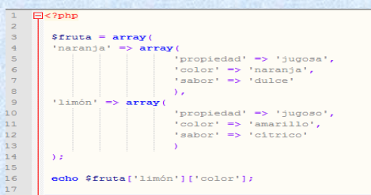


!!! exercise "Ariketa 19"
    - [ ] Eginda dut

    Sortu matriz multidimentsionala ikasleen datuak gordetzeko.
    Array nagusiaren klabea ikaslearen “izena” izango da eta array honek beste array bat izango du barruan. 
    Hurrengoko datuekin:

    - Abizenak

    - Adina

    - Zikloa

    Behin sortuta foreach estrukturarekin pantailan erakutsiko dugu. Zenbat foreach beharko ditugu?

    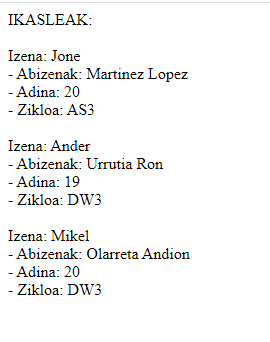  


## Matrizeetan nabigatzea
- Matrize indexatuak direnean, erraza da array baten zehar nabigatzea, baina matrize multidimensaionala denean, ez da ain erraza izaten.

- Horretarako, funtzio-multzo bat dago aurrefabrikatuak, ekintza ugari: `count()`, `reset()`, `end()` etab…

- Hurrengo estekan dituzue Array-en funtzioen zerrenda:
    <a href="https://www.php.net/manual/es/ref.array.php">Array-en funtzioen zerrenda</a>


### count()
Array baten elementu kopurua itzultzen du:

```php
<?php
    $zenbakiak = array(1, 2, 3, 4, 5);
    echo count($zenbakiak);  // 5
?>
```
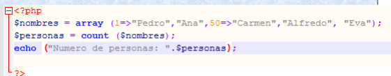   
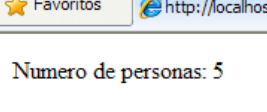   


### in_array()
Elementu bat array baten dagoen egiaztatzen du:

```php
<?php
$koloreak = array("gorria", "berdea", "urdina");
if (in_array("berdea", $koloreak)) {
    echo "Berdea badago arrayan";
}
?>
```

!!! exercise "Ariketa 20: Ikasleen notak"
    - [ ] Eginda dut
    
    Sortu PHP script bat eta idatzi kodea honako funtzionalitateekin:
    
    1. Sortu array asoziatiboa ikasleen izenekin eta haien notekin
    2. Bistaratu ikasle bakoitzaren izena eta nota
    3. Kalkulatu batez besteko nota
    
   
!!! exercise "Ariketa 21: Ikasleen datuak"
    - [ ] Eginda dut
    
    Sortu PHP script bat eta idatzi kodea honako funtzionalitateekin:
    
    1. Sortu array multidimentsionala ikasleen datuekin:

       - Izena
       - Abizena
       - Adina
       - Zikloa

    2. Erabili foreach egitura bikoitza datuak erakusteko
    

!!! info "Aholku erabilgarriak"
    - Erabili `print_r()` edo `var_dump()` array-ak aztertzeko
    - Gogoan izan array-ak 0-tik hasten direla indexatzen
    - Erabili `foreach` egitura array-etan zehar ibiltzeko
    


## Matrizeetan nabigatzea
- `reset(array);` Barruko erakuslea lehen postura itzuli da
- `end(array);` Barruko erakuslea azken postura doa
- `next(array);` Erakuslea hurrengo elementura doa
- `prev(array);` Sartu aurreko elementura
- `current(array);` Uneko (actual) elementuaren edukia itzultzen du


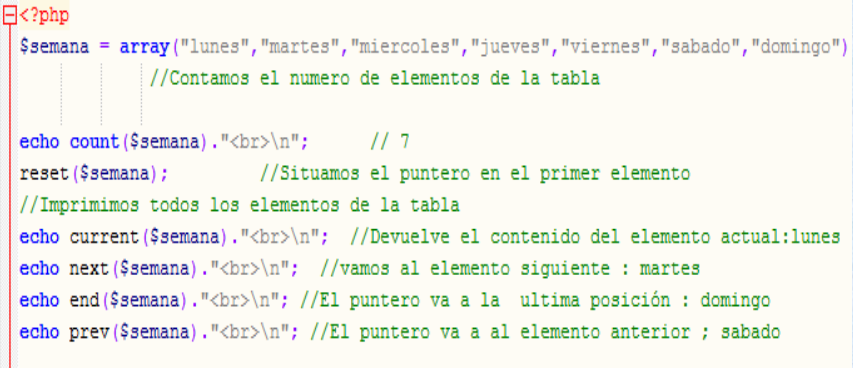

## Elementuak txertatzea
Array baten barruan elementuak txertatzeko PHP-k hainbat funtzio eskaintzen ditu:

### array_push()

Array baten bukaeran elementuak gehitzen ditu.

```php
    $koloreak = ["gorria", "berdea"];
    array_push($koloreak, "urdina", "horia");
    // Emaitza: ["gorria", "berdea", "urdina", "horia"]
```

### array_unshift()
Array baten hasieran elementuak gehitzen ditu, beste elementuak atzeraka mugituz.

```php
    $zenbakiak = [3, 4];
    array_unshift($zenbakiak, 1, 2);
    // Emaitza: [1, 2, 3, 4]
```

### array_pad()
Array baten tamaina handitzen du, beharrezkoa bada, balio lehenetsi betez.

```php
    $array = [1, 2];
    $berria = array_pad($array, 5, 0);
    // Emaitza: [1, 2, 0, 0, 0]

    // Tamaina negatiboa erabiliz hasieran betetzeko
    $berria = array_pad($array, -5, 0);
    // Emaitza: [0, 0, 0, 1, 2]
```

### array_merge()
Bi edo array gehiago batzen ditu.

```php
    $array1 = ["a" => "sagarra"];
    $array2 = ["b" => "madaria"];
    $emaitza = array_merge($array1, $array2);

    // Emaitza: ["a" => "sagarra", "b" => "madaria"]
```

### + Operadorea

```php
    $array1 = [1, 2];
    $array2 = [3, 4];
    $emaitza = $array1 + $array2;  // Lehenengo array-aren gakoak mantentzen ditu

    // Emaitza === [1, 2]
    // ($array2-ren elementuak ez dira gehituko haien gakoak $array1-n daudelako)
```

Hau gertatzen da PHPn `+` eragileak ez dituelako elementuak kontzentratzen, baizik eta gako bakarrak mantenduz lotura bat egiten duelako. Bi arrayek gako berak dituztenez (0 eta 1), `+` eragileak ezkerreko arrayaren balioak mantentzen ditu ($array1) eta gakoak bikoiztuta dituzten eskuineko arrayaren balioak baztertzen ditu ($array2).

!!! tip "Bi array-en batura egiteko"
    - `array_merge()` erabili beharko genuke

!!! exercise "Ariketa 22"
    - [ ] Eginda dut

    - Badugu ondorengo array bat:

    ```
        $frutak = array("laranja", "platanoa");
    ```

    - Gehitu beste bi elementu (limoia eta sagarra) `array_push()` funtzioarekin.

## Array funtzio gehiago...

- `array_unshift(matrizea,aldagai1,aldagaiN);`
    - Funtzioaren hasieran elementuak gehitzen ditu besteak atzeruntz botatzen.

- `array_pad(matrizea,berria,balio_betegarria);`
    - Matrizearen tamaina handitzen du balio bat erabiliz betegarri gisa.

- `array_shift(matrizea);`
    - Matrizeko lehenengo elementua ezabatzen du

- `array_pop (matrizea);`
    - Matrizeko azkeneko elementua ezabatzen du

- `array_splice(matrizea, pos_ini,[tamaina],[ordezkoak]);`
    - Matrize baten zati baten edukia ordezkatzeko edo ezabatzeko erabiltzen da. Horretarako, posizioa zehaztu behar dugu, zenbat elementu ordezkatuko diren eta ordezkoak zeintzuk izango diren (baldin eta elementuren batekin ordezkatu nahi dugun).

- `array_keys(matrizea,[bilatutako balioa]);`
    - Honek esaten digu array baten klabeak. Balioagarria da elementu bat ezabatu behar dugunerako eta ez baldin badakigu zein posiziotan dagoen

- `array_values (matrizea);`
    - Honek bueltatzen ditu array baten balioak

- `array_slice(matrizea,posizioa,tamaina);`
    - Funtzio honek array baten zati bat bueltatzen du, esaten diogu non hasi behar duen zatitzen eta zenbat elementu nahi ditugun.
- Ez badugu tamaina jartzen, bukaerararte egingo du.

## Arrayak ordenatzen

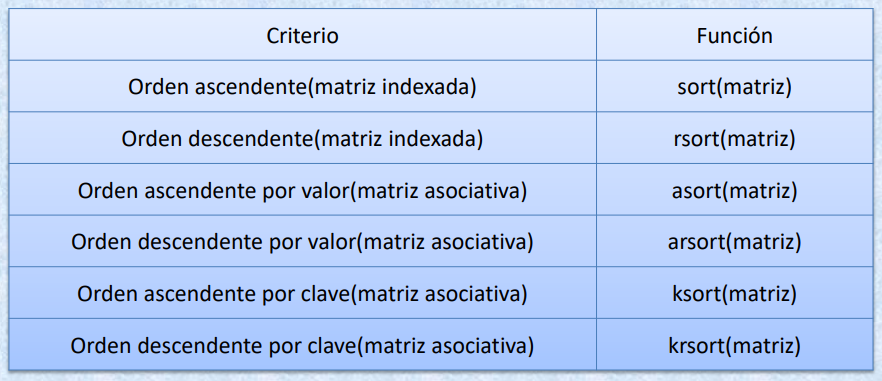

### Print_r

    print_r funtzioak bueltatzen digu array baten klabeak eta balioak. Klabeak kortxeteen artean bueltatzen ditu eta balioak => seinuaren atzean.

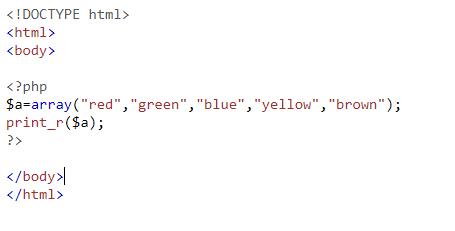

- Irteera:
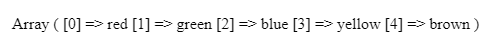


!!! exercise "Ariketa 23"
    - [ ] Eginda dut

    - Hamar film-titulu dituen array bat definitu.
    - Sort funtzioa erabili alfabetikoki ordenatu eta print_r bidez pantailan bistaratu

### unset()
- Parentesien artean esandako elementua ezabatzen du. Hurrengo irudian dago adibide bat

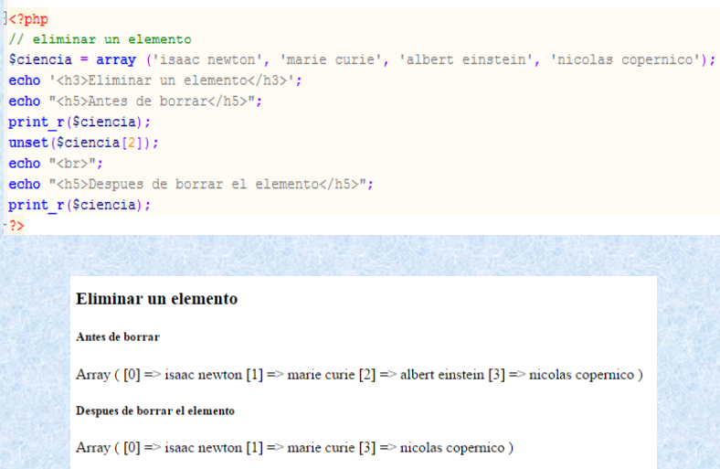

!!! exercise "Ariketa 24"
    - [ ] Eginda dut

    Array hau emanda:

        ```
        $paises = array (“alemania’,’brasil’,’italia’,’txile’,’uruguay’,’australia’)
        ```
    Hau eskatzen da:

        - 1. ‘Alemania’, ‘italia’ eta ‘australia’ elementuak kentzea.
        - 2. ‘Argentina’ eta ‘bolivia’ elementuak txertatzea
        - 3. Ordenatu array alfabetikoki
        - 4. Bistaratu emaitza print_r pantailaz

### Var_dump
- Var_dump funtzioak bueltatzen digu array baten elementu zenbakia parentesien artean eta barneko estruktura datu mota guztiak zehazten.

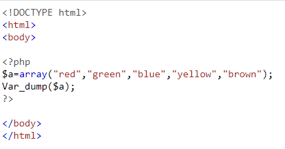

- Irteera:
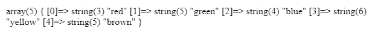

!!! exercise "Ariketa 25"
    - [ ] Eginda dut

    - Karaktere bateko gakoak dituen array bat definitu, kareakterak ‘a’tik ‘f’rarte joango dira.
    - Definizio berean, gako bakoitzari letra horrekin hasten den izen propio bat eman. Adibidez (“a”=’Amanda’);
    - Erakutsi emaitza pantailan var_dump erabiliz

!!! exercise "Ariketa 26"
    - [ ] Eginda dut
        
    - Hartuko dugu, "Ariketa 16: Zenbakia asmatu", eta array batekin kontrolatuko dugu hautazko zenbakia ez errepikatzea.
    - Errepikatzen bada mezu bat aterako dugu, eta ez dugu saiakeren kopurua gehituko.
    - Mezua adibidez: Zenbakia 5 berriro aukeratu duzu, saiatu berriz.

### array_rand
- Array barruan dauden elementu guztien artean elementu bat hartzen du “aleatorio” moduan.
- Funtzio honek bi parametro izan ditzake, alde batetik arraya, hori derrigorrezkoa da, eta bestetik aukerazko beste parametro bat, zenbat elementu nahi ditugun zehazteko.
- <https://www.w3schools.com/php/func_array_rand.asp>

!!! exercise "Ariketa 27"
    - [ ] Eginda dut
    
    - Zure bidaia-desioen zerrenda
    Imajinatu bidaia egiteko gogoko dituzun herrialdeen zerrenda bat antolatzen ari zarela, eta zerrenda hori arrayak erabiliz kudeatu behar duzula.

    - Argibideak:
        - Sortu `$desio_zerrenda` izeneko array bat, bidaiatu nahi zenituzkeen bost herrialderekin.
        - Erabili beharrezko funtzioa  bi herrialde gehiago gehitzeko zerrendara.
        - Orain bi zerrenda gehigarri dituzu, azken bi urteetan bidaiatu dituzun herrialdeekin, adibidez:

            - `$bisitatuak_2022 = array('Italia', 'Frantzia')`
            - `$bisitatuak_2023 = array('Portugal', 'Japon')`
        - Bi zerrenda horiek batu array bakarrean `$bisitatuak_guztiak`.
        - Ezabatu errepikatzen diren herrialdeak `$desio_zerrenda`-tik. Hau da, bidaiatu dituzun herrialdeak ezabatu nahi dituzu zure desioen zerrendatik.
        - Azken desioen zerrenda alfabetikoki ordenatu.
        - Emaitza pantailaratu.
