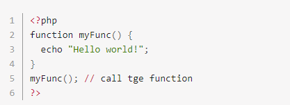
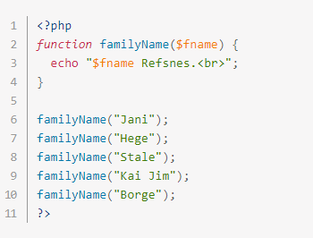
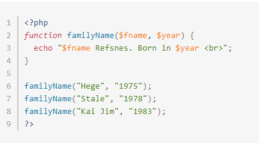
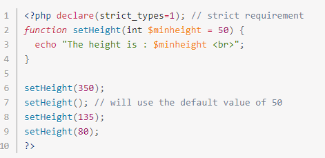
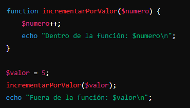
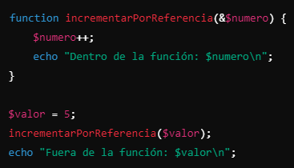
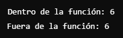
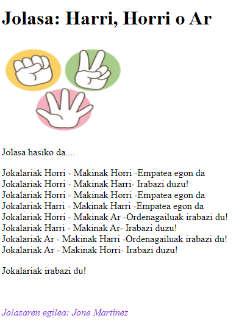
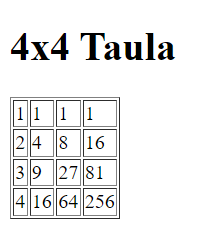

# DWS - 2. unitatea - Funtzioak

## Sarrera
- Funtzioak PHP-n kode berrerabilgarria sortzeko modu eraginkorra dira
- Kodea modulu txikietan banatzen dute, errazago mantentzeko eta arazteko
- PHPk funtzio integratu ugari ditu, baina zuk ere zureak sor ditzakezu.
- Bi mota daude, `kanpokoak` eta `barnekoak`, hau da, script-ean sartzen ez direnak baina kanpoko artxibo batean eskuragarri daudenak eta script-ean sartzen direnak.
- Hauei ezker beraz, kodea errezago irakurriko da, agindu berdinak ez ditugu behin eta berriro errepikatu behar izango etab…


### Funtzio baten oinarrizko egitura

```php
<?php
    function kaixoMundua() {
        echo "Kaixo, mundua!";
    }

    // Funtzioa deitzea
    kaixoMundua();
?>
```

- Funtzio bat lan bat edo gehiago egiten dituen kode bloke bat.
- Izen batekin identifika dezakegu deitzeko eta parametro edo argudioak ere pasa ditzazkegu.
- Aldi berean balio bakar itzultzeko aukera du ere.
- Funtzioak noiznahi dei daitezke beharrezko denean eta abantaila nagusi hau izatea: kodea berrerabiltzeko aukera ematen digute, beharrik ez izateko berriz idatzi.
- Funtzioaren kodea bakarrik exekutatuko da funtzioari deitzen zaionean.


## Funtzio motak

### 1. Hizkuntzaren jatorrizkoak
PHPrekin batera datozen funtzioak:

```php
<?php
    $luzera = strlen("Kaixo");  // 5
    $majuskulak = strtoupper("kaixo");  // "KAIXO"
?>
```

### 2. Hizkuntzaren hedadurak (extensión)
Gehigarri gisa instalatu behar diren funtzioak:
- PHPtik kanpoko liburutegietan daude, eta, beraz, berariaz instalatu behar dira

- PHPren banaketarekin, hainbat luzapen gehitu egiten dira, baina izan daiteke funtzionatzeko prest egotea, hau da “habilitatutik” ez egotea.

- Horiek aktibatzeko php.ini fitxategian egin beharko da.

- Hurrengo estekan dituzue PHPk barnean dituen funtzioen zerrenda:
[Listado de Funciones y Métodos](https://www.php.net/manual/es/indexes.functions.php)

- PHP lengoaiarako luzapenak lortzeko PECL erabil dezakezu
- PECL PHP-rako luzapenen biltegi bat da
- `pecl` komandoa erabiliz instalatu daitezke luzapenak
- PECL instalazioari buruzko informazio gehiago: [PHP PECL dokumentazioa](https://www.php.net/manual/en/install.pecl.php)


### 3. Erabiltzaileak definitutakoak
Zuk sortutako funtzio pertsonalizatuak:

```php
<?php
    function batuBiZenbaki($a, $b) {
        return $a + $b;
    }

    echo batuBiZenbaki(5, 3);  // 8
?>
```

## Funtzio baten definizioa
Funtzio bat definitzeko, `function` erreserbatutako hitza erabili behar dugu.

PHP funtzio pertsonalizatu bat deklaratzeko, erabili sintaxi orokor hau:
```php
function funtzioIzena($parametro1, $parametro2) {
    // kodea hemen
    return $emaitza;
}
```



- Goiko adibidean, funtzioa `function` gako-hitza erabiliz deklaratzen da. Horren ondoren, parentesi biribilak `function ()` funtzioaren hasiera adierazten du.

- Funtzioaren kode-blokea `{`-rekin hasten da eta `}`-rekin amaitzen da.

- PHPk ez du maiuskulak eta minuskulen artean bereizten, beraz Adibide () eta adibide () funtzio bera izango zen berez, baina ohitura hartu behar dugu beti modu berdinean izendatzen, eta hoberena minuskuletan egitea izango litzateke.

- PHPk ere horrela egiten bait du.

- Parentesiak beti dira derrigorrezkoak funtzioa definitzerakoan eta baita deitzerako momentuan, naiz eta parametrorik izan ez.

### Funtzio baten argudioak

Funtzioen parentesi barruko parametroei funtzio argumentuak deitzen zaie. Funtzioen argumentuak bakarrak edo anitzak izan daitezke. Funtzio anitzeko argumentuak komaz bereizten dira.

Parametro bakarreko adibidea dugu hau:



Zer uste duzu aterako duela pantailatik?

- 2 parametrodun funtzioa horrela izango litzateke:



### Parametroen balio lehenetsia

- Funtzio batek balio lehenetsi bat eslei diezaioke argumentuari. 

- Funtzioari deitzea ahalbidetzen du argumentu hori pasatu gabe. 

- Argumentu nahikorik ez duen funtzio bati deitzen saiatzen bazara, errore bat emango du. 

- Hala ere, beti dago hori saihesteko moduren bat, parametroari balio lehenetsia emanez.



- Izan kontutan balio lehenetsia ezin dela aldagai bat izan, expresio bat baizik.

- Balio lehenetsia duten parametroak beti azkenekoak izan behar dira.

```php
    function muestranombre ($nombre, $titulo= "Sr."){
        print "Estimado $titulo $nombre:\n";
    }

    muestranombre (“Fernández”);
    muestranombre (“Fernández”, "Prof.");

    //Irteera:

    //Estimado Sr. Fernández:
    //Estimado Prof. Fernández:
```

### Parametroak erreferentziaz pasatzea
- Aldagai bat erreferentziarik gabe erabiltzen bada, ezin izango duzu funtzioaren barruko balioa aldatu. Hobeto esanda, kasu honetan, OSak argumentuaren bi kopia sortzen ditu. 

- Funtzioaren barruan argumentuaren balioa aldatuz gero, kopiaren balioa aldatuko litzateke. 

- Bestalde, aldagai bat erreferentziaz pasatzen bada (`&` ikurra erabiliz), ez du kopia berria sortzen, aldagaiaren helbidea pasatzen du. Beraz, funtzioen barruko balioa aldatzeak jatorrizko argumentuaren balioa aldatuko du.

#### Parametroak "Por valor"


Bi aldagai ezberdinak dira, lehenengo aldagaiaren kopia bat egiten du:


#### Parametroak "Por referencia"


Ez du kopiarik egiten, aldagaiaren helbidea pasatzen du

  

### Balioak itzuli
`return` instrukzioak funtzioaren exekuzioa geldiarazten du eta balioa itzultzen du.

```php   
    function sum(int $x, int $y) {
        $z = $x + $y;
        return $z;
    }

    echo "5 + 10 = " . sum(5, 10) . "<br>";
    echo "7 + 13 = " . sum(7, 13) . "<br>";
    echo "2 + 4 = " . sum(2, 4);
?>
```

!!! exercise "Ariketa 28"
    - [ ] Eginda dut
    
    Bi zenbaki jasotzen dituen php funtzio bat egiten du, eta haien batezbesteko aritmetikoa itzultzen du. 
    Froga ezazu funtzioa adibide batekin

    
!!! exercise "Ariketa 29"
    - [ ] Eginda dut
    
    Sortu funtzio bat erreferentziazko parametro bat jasotzen duena, unitate baten gehitzen du. Froga ezazu funtzioa adibide batekin.

!!! exercise "Ariketa 30"
    - [ ] Eginda dut
    
    Produktu baten BEZa kalkulatzeko balio duen funtzio bat egiten du. 
    Bi parametro izango ditu: lehenengoak salneurria, eta bigarrenak aplikatu beharreko BEZa. 
    Hautazkoa izango da, eta, jasotzen ez bada, %21eko BEZa kalkulatuko da. Froga ezazu funtzioa adibide batekin

## `global` eta `static` deklarazioak

### `global` deklarazioa
`global` hitza barik funtzioaren barruan `$a` ez legoke definiturik eta Warning aterako litzateke programan….

```php
<?php
    $a = 5;
    function froga (){
        global $a;
        $b = $a;
        print "a aldagaiaren balioa da $a eta b aldagairena $b";
    }
    froga ();
?>
```

### `static` deklarazioa

`static` aldagai estatikoak deklaratutako sententzia berean hasieratu behar dira, horrela funtzioa deitzen zaion lehenengo aldian bakarrik hasieratuko da.
Aldagai honek ez du bere balioa galtzen deitzen dugun bakoitzean.

```php
<?php
    function froga (){
        static $a = 0;
        $a++;
        // $a aldagaia funtzioari deitzen zaion bakoitzean handitzen da
    }
    froga ();
?>
```
!!! exercise "Ariketa 31"
    - [ ] Eginda dut
    
    Funtzio bat duen programa bat egiten du, 0 balioarekin hasieratuko duen aldagai estatiko batekin, eta, deitzen den bakoitzean, handituko dugu baten balio hori, funtzioak balioa bueltatuko du. 
    
    Behin funtzioa sortuta duzunean, deitu funtzioari 3 aldiz, eta bistaratu itzulitako balioa funtzioari deitzen diogun bakoitzean.


!!! exercise "Ariketa 32"
    - [ ] Eginda dut
    
    Programa bat sortu behar duzu, ikasleen eta haien kalifikazioen erregistroa eramateko. Horretarako array asoziatibo bat erabili behar duzu informazio guztia hori gordetzeko.

    - `ikasleaSortu()` funtzioa sortuko dugu, hiru parametro onartzen dituen funtzioa: ikaslearen izena, adina eta kalifikazioa adierazten dituena. Funtzioak ikaslea erregistrora gehitu eta erregistro eguneratua itzuli behar du.
    - Sortu ezazu ikaslearen izena eta erregistro osoa erakusten duen funtzioa. Funtzio honek ikaslea erregistroan izatekotan, bere izena, adina eta kalifikazioa erakutsi behar ditu, bestela erregistroan ez dagoela idatziko du. `ikasleaErakutsi()` izena izango du funtzioak.
    - Funtzio horiek erabiliko dituen programa nagusi bat sortuko duzu, erregistroan gutxienez hiru ikasle sartzeko, eta informazioa erakusteko. 

!!! exercise "Ariketa 33"
    - [ ] Eginda dut
    
    Aurreko ariketari buelta bat emango diogu…
    
    Oraingo honetan, ikasleen kalifikazioak bat bakarra izan beharrean, 6 izango dira, modulu guztien kalifikazioak. Beraz, arraya aldatu beharko da, multidimesionala bihurtzen.
    
    Eta bestetik, funtzio berri bat sortu behar duzu, `batazbestekoa()` izenarekin, non ikasle baten erregistroa onartu eta kalifikazioen batez bestekoa kalkulatzen duen. Funtzioak kalkulatutako batezbestekoa itzuli behar du.


## Errekurtsibitatea
- PHPk errekurtsibitatea onartzen du ere, hau da, funtzio batek bere buruari deitu diezaioke. 
- Hau da, funtzioaren kodearen barruan badago funtzio horreri egindako deia, hori bai, beste parametro bategaz.
- Adibide klasikoa: faktoriala kalkulatzea

```php
<?php
    function factorial($n) {
        if ($n <= 1) {
            return 1;
        } else {
            return $n * factorial($n - 1);
        }
    }

    echo factorial(5);  // 120
?>
```


## include() eta require()
- Bi funtzio hauek kanpoko fitxategiak kargatzeko erabiltzen dira:
  - `include()`: fitxategian dagoen kodea modu literal baten txertatzen dugu gure scriptean
  - `require()`: honegaz esaten diogu gure scriptak beharko duela fitxategi horretan dagoen kode zati bat
  - `include_once()` eta `require_once()`: Fitxategia behin bakarrik kargatzeko bermatzen dute

  Horrek fitxategiak ez dute zertan php fitxategiak izan behar, edozein motatakoa izan daiteke.

### include()

```php
    <?php
        // header.inc
        $izenburua = "Nire Webgunea";
    ?>

    <header>
        <h1><?php echo $izenburua; ?></h1>
    </header>

    <?php
    // index.php
    include 'header.inc';
    ?>

    <main>
        <p>Eduki nagusia hemen</p>
    </main>
    <?php include 'footer.inc'; ?>
```

### require()

```php
<?php
    // config.inc
    define('DB_HOST', 'localhost');
    define('DB_USER', 'erabiltzailea');
    define('DB_PASS', 'pasahitza');

    // index.php
    require 'config.inc';

    // Konexioa egiteko erabiliko dugu
    try {
        $konexioa = new PDO(
            "mysql:host=" . DB_HOST . ";dbname=nire_db",
            DB_USER,
            DB_PASS
        );
    } catch (PDOException $e) {
        die("Ezin izan da konexioa egin: " . $e->getMessage());
    }
?>
```

- Bi funtzio hauen arteko ezberdintasun bat da ere, includen edo requiren dagoen fitxategi bat faltatzekotan, includeren kasuan warning bat aterako da, baina scripta exekutzatzen jarraituko du, aldiz require-ren kasuan errorea emango du eta scripta geldituko da.


!!! exercise "Ariketa 34"
    - [ ] Eginda dut

    - "Harri, Horri, Ar" jolasa programatuko dugu. Lehenengo eta behin, array bat sortuko dugu 3 aukerekin: 0 - Harri, 1 - Horri, 2 - Ar.
    - Alde batetik, programak hautazko aukera bat egingo du (random batekin) eta jokalariarentzat beste aldagai bat sortuko dugu, eta hautaz ere aukeratuko da.
    - Funtzio bat sortuko dugu konparaketa egiteko jokalari eta makinaren aukeren artean.
    - 3 biderretan irabazten duenak, jolasa irabaziko du.
    - Konparaketa egiteko funtzio bat sortuko dugu: `irabazleaAukeratu()`

    

    - `include()` erabili goiko partea (irudia barne) egiteko eta footerra egiteko ere (autorea…)


!!! exercise "Ariketa 35"
    - [ ] Eginda dut

    Orrialde bat sortu, horretan, sartu goiburua eta orri-oina include() funtzioarekin. 
    
    0tik 5era bitarteko zenbaki bat aukeratuko dugu (random), eta zenbaki horrekin hau izango da, egin beharrekoa ( Switch() estruktura erabiliko dugu);

        - 0-– “Ez du sarbiderik” mezua aterako du eta beste zenbaki bat aterako du.
        - 1-– Ongi etorri, egun on bat pasa! Mezua aterako du
        - 2-– Zenbaki baten biderketa-taula erakutsiko du (1etik 10era ausaz ateratakoa) elementu bakoitza zenb x 1 = balioa, zenb x 2= formakoa izango den taula batean balioa… Honetarako funtzio bat sortu beharra dago
        - 3 -– 4 zutabeko taula batean, erakutsi 4 irudi. Honetarako ere funtzio baten egin-
        - — Ez badago 0 eta 3ren artean “Zenbakia ez dago 0 eta 3 artean” mezua atera behar da.

!!! exercise "Ariketa 36"
    - [ ] Eginda dut

    - Erakutsi 4 bider 4ko taula bat, lehenengo 4 elementuen berreketak (php-ko [pow()](https://www.php.net/manual/es/function.pow.php) funtzioa erabili dezakezue) erakutsi (kalkuluak egiteko, behar dituen funtzioak sortu).

    
