# DWS - 2. unitatea - Kontrol egiturak

## Sarrera
- Kontrol-egiturek programaren exekuzio-fluxua kontrolatzen dute
- PHP-n kontrol-egitura nagusiak:
  - Baldintzazkoak: `if`, `else`, `elseif`, `switch`
  - Begiztak: `for`, `while`, `do-while`, `foreach`
  - Beste batzuk: `break`, `continue`, `goto`

## Baldintzazko egiturak

### If-else adierazpena

```php
<?php
    $adina = 18;

    if ($adina >= 18) {
        echo "Adin nagusikoa zara";
    } else {
        echo "Adin txikikoa zara";
    }
?>
```

### Elseif erabiliz

```php
<?php
    $nota = 7.5;

    if ($nota >= 9) {
        echo "Bikain!";
    } elseif ($nota >= 7) {
        echo "Oso ondo!";
    } elseif ($nota >= 5) {
        echo "Ondo!";
    } else {
        echo "Hurrengo bidean hobeto!";
    }
?>
```


!!! exercise "Ariketa 7: Adina konprobatu"
    - [ ] Eginda dut

    Sortu PHP script bat `ariketa7.php` izenekoa, eta idatzi kodea honako funtzionalitateekin:

    1. Sortu aldagai bat `$adina` izenekoa
    2. Erabili `if-else` egitura adina 18 baino handiagoa den konprobatzeko
    3. Erakutsi mezu egokia:
    - 18 edo gehiago bada: "Pasa zaitezke"
    - Bestela: "Ondino adingabekoa zara, ezin zara pasatu"

    **Adibidea:**
   
        Sartu zure adina: 20 - Mezua:  Pasa zaitezke
 

!!! exercise "Ariketa 8: Zenbakiaren balioa"
    - [ ] Eginda dut

    Sortu PHP script bat `ariketa8.php` izenekoa, eta idatzi kodea honako funtzionalitateekin:

    1. Sortu aldagai bat `$zenbakia` izenekoa
    2. Erabili `if-else` egitura zenbakia 0 eta 10 artean dagoen konprobatzeko
    3. Erakutsi mezu egokia:
    - 0-10 artean badago: "Zenbakia X da" (non X sartu den zenbakia den)
    - Bestela: "Zenbakia ez dago 0 eta 10en artean"

    **Adibideak:**

        * Zenbakia: 5
        Mezua:  - Zenbakia 5 da
        * Zenbakia: 15
        Mezua:  - Zenbakia ez dago 0 eta 10en artean


### Switch egitura

Switch egitura balio bat hainbat aukeratatik konparatzeko erabiltzen da.

```php
<?php
    $eguna = date("N"); // 1 (astelehena) - 7 (igandea)

    switch ($eguna) {
        case 1:
            echo "Astelehena";
            break;
        case 2:
            echo "Asteartea";
            break;
        case 3:
            echo "Asteazkena";
            break;
        case 4:
            echo "Osteguna";
            break;
        case 5:
            echo "Ostirala";
            break;
        default:
            echo "Asteburua!";
    }
?>
```

!!! warning "Ohar garrantzitsuak"
    - `break` erabili behar da kasu bakoitzaren amaieran
    - `default` aukerakoa da eta kasurik bat ere ez denean exekutatuko da
    - Kasuak konstante sinpleak izan behar dute (ez dira onartzen adierazpen konplexuak)


!!! exercise "Ariketa 9: Switch erabiliz"
    - [ ] Eginda dut

    Bihurtu hurrengo kodea `if-else` egitura duena `switch` egitura erabiliz:

        $aldagaia = 2;

        if ($aldagaia == 1) {
            echo '$aldagaia berdin 1.';
        } else if ($aldagaia == 2) {
            echo '$aldagaia berdin 2.';
        } elseif ($aldagaia == 3) {
            echo '$aldagaia berdin 3.';
        } else {
            echo '$aldagaia ez da ez 1, ez 2 ezta 3.';
        }
    


!!! exercise "Ariketa 10: Zenbakia asmatu"
    - [ ] Eginda dut

    Bihurtu hurrengo kodea `if-else` egitura duena `switch` egitura erabiliz:

  
        $aldagaia = 2;

        if ($aldagaia == 1) {
            echo '$aldagaia berdin 1.';
        } else if ($aldagaia == 2) {
            echo '$aldagaia berdin 2.';
        } elseif ($aldagaia == 3) {
            echo '$aldagaia berdin 3.';
        } else {
            echo '$aldagaia ez da ez 1, ez 2 ezta 3.';
        }


## Operadore logikoak

### Operadore logiko nagusiak:

1. **OR (`||`)** - Baldintza bat behintzat betetzen denean

   ```php
   if ($izena == "Garazi" || $abizen1 == "Olabarria") {
       // Kodea exekutatuko da baldintzetako bat betetzen bada
   }
   ```

2. **AND (`&&`)** - Baldintza guztiak bete behar direnean

   ```php
   if ($adina >= 18 && $baimena == true) {
       // Kodea exekutatuko da baldintza guztiak betetzen badira
   }
   ```

3. **NOT (`!`)** - Emaitza alderantzikatzeko

   ```php
   if (!empty($erabiltzailea)) {
       // Kodea exekutatuko da $erabiltzailea ez bada hutsik
   }
   ```

!!! exercise "Ariketa 11: Sarbidea konprobatu"
    - [ ] Eginda dut

    Sortu PHP script bat `ariketa11.php` izenekoa, eta idatzi kodea honako funtzionalitateekin:

    1. Sortu hiru aldagai:
        - `$izena`: erabiltzailearen izena
        - `$abizen1`: lehen abizena
        - `$abizen2`: bigarren abizena
    2. Erabili operadore logikoak hurrengo baldintzak egiaztatzeko:
        - Izena "Garazi" den
        - Edo abizenak "Olabarria Iriondo" diren
    3. Baldintza betetzen bada, erakutsi "Ongi etorri $izena $abizen1 $abizen2!"
        - Bestela, erakutsi "Ez du sarbiderik"

    **Adibidea 1:**
    ```
    Izena: Garazi
    Abizena 1: Perez
    Abizena 2: Lopez
    Mezua: Ongi etorri Garazi Perez Lopez!
    ```

    **Adibidea 2:**
    ```
    Izena: Aitor
    Abizena 1: Olabarria
    Abizena 2: Iriondo
    Mezua: Ongi etorri Aitor Olabarria Iriondo!
    ```

    **Adibidea 3:**
    ```
    Izena: Jon
    Abizena 1: Garcia
    Abizena 2: Lopez
    Mezua: Ez du sarbiderik
    ```

## Iterazioak (Begiztak)

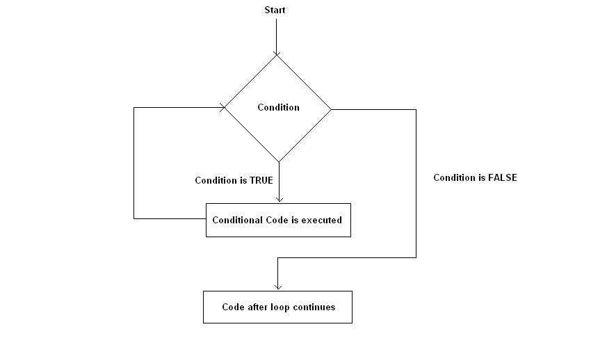

### For begizta
Kontagailu baten balioaren arabera, zehaztutako kode.lerroak exekutatuko dira:

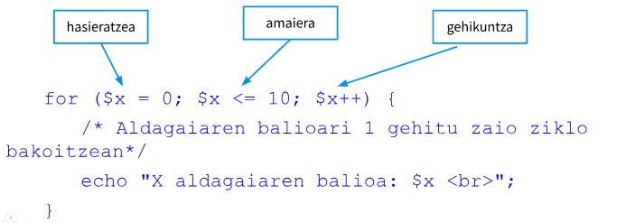

```php
<?php
    // 1tik 10era zenbakiak inprimatu
    for ($i = 1; $i <= 10; $i++) {
        echo "Zenbakia: $i<br>";
    }
?>
```


!!! warning "Bukle infinituak"  

    Bukle infinitu bat gertatzen da begiztaren baldintza inoiz betetzen ez denean. 
    
    Adibidez:
    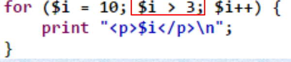
    
    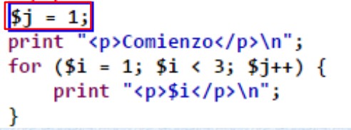
    


### Bukle anidatuak

- Bukle anidatua dela esaten dugu, bukle bat beste bloke baten sententzia kodean dagoenean. 
- Bukleek edozein maila izan dezakete, bat beste baten barruan, horren barruan beste bat etab...
- Barruko bukleari `barne buklea` deritzogu. Eta kapnkoari `kanpo buklea`.
- Kontuz ibili barneko begiztako aldagaiekin, hoberena aldagai izen ezberdinak erabiltzea da:

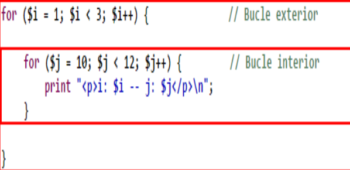


!!! exercise "Ariketa 12: Biderketa taula (for)"
    - [ ] Eginda dut
    
    Idatzi programa bat honako funtzionalitateekin:
    
    1. Sortu aldagai bat `$zenbakia` eta esleitu balio bat (adibidez, 5)
    2. FOR begizta erabiliz, biderketa taula erakutsi formatu honetan:
    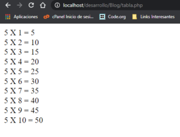
   

!!! exercise "Ariketa 13: Taula sortzea (for anidatuak)"
    - [ ] Eginda dut
    
    FOR anidatuak erabiliz ondorengo taula moduko bat sortu. Horretarako html kodea sartu beharko duzu
    
    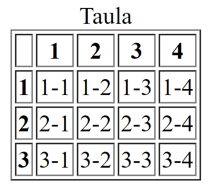
    
    

!!! exercise "Ariketa 14: Zenbaki bikoitiak"
    - [ ] Eginda dut
    
    Sortu programa bat 5 eta 50 bitarteko zenbaki bikoitiak koma batekin bananduta erakutsiko duena. **Azken koma ez erakutsi**.
    
    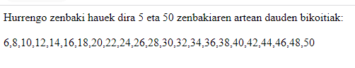
    


### While begizta

- Baldintza bat betetzen den bitartean, zehaztutako kode-lerroak exekutatuko dira.
- Aldagia aldatzen joan behar du bukle infinito baten sartu ez gaitezen.

```php
<?php
    $kontagailua = 1;
    while ($kontagailua <= 5) {
        $kontagailua++;
    }

    echo "Zenbakia: $kontagailua<br>"; // Irteera: Zenbakia: 6
?>
```
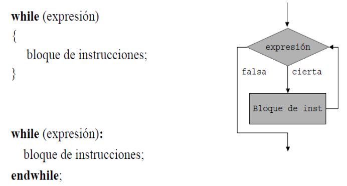


!!! exercise "Ariketa 15: Biderketa taula (while)"
    - [ ] Eginda dut
    
    Berridatzi aurreko biderketa taula `while` begizta erabiliz. 
    
    

### Do-While begizta

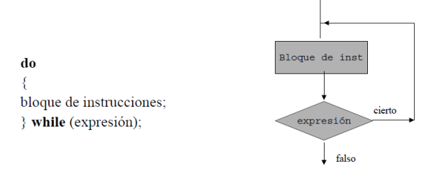

Aurrekoaren antzeko begizta da; kasu honetan, ordea, bukaeran ebaluatzen da adierazpena; beraz, begiztaren sententzia edo sententzia multzoa behintzat behin exekutatuko da.

```php
<?php
    $kontagailua = 1;
    do {
        echo "Zenbakia: $kontagailua<br>";
        $kontagailua++;
    } while ($kontagailua <= 5);

    // Irteera: Zenbakia: 1 Zenbakia: 2 Zenbakia: 3 Zenbakia: 4 Zenbakia: 5
?>
```
!!! exercise "Ariketa 16: Do-while erabiliz"
    - [ ] Eginda dut
    
    Idatzi programa bat eta erakutsi 0tik 10erako zenbakiak `do-while` erabiliz.
    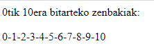
    
   
### Foreach begizta (array-ekin)

Foreach iterazioa array-ekin erabili ohi da. Iterazioak array-a zeharkatuko du eta elementu bat aurkiten duen bakoitzean, zehaztutako kode-lerroak exekutatuko ditu.

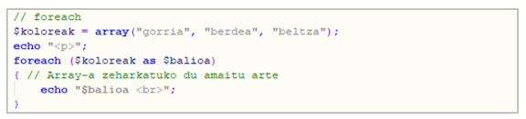    

Array asoziatiboentzat, beste modu hau erabiliko genuke, klabea eta balioa atera ahal izateko:

```php
<?php

    $ikasle = [
        "izena" => "Ane",
        "abizena" => "Garcia",
        "adina" => 22,
        "email" => "ane.garcia@ikasle.eus",
        "notak" => [7.5, 8.0, 9.2, 7.8]
    ];


    foreach ($ikasle as $gakoa => $balioa) {
        echo "$gakoa: $balioa<br>";
    }
?>

    **Irteera:**

    izena: Ane
    abizena: Garcia
    adina: 22
    email: ane.garcia@ikasle.eus
    notak: 7.5, 8, 9.2, 7.8
```
!!! info "Adibidea"
    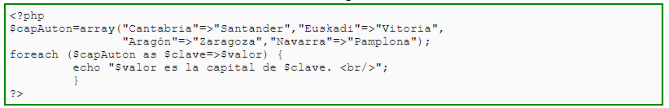

    **Irteera:**

    - Santander es la capital de Cantabria.

    - Vitoria es la capital de Euskadi.

    - Zaragoza es la capital de Aragón.

    - Pamplona es la capital de NAvarra.

!!! warning "KONTUZ!"
    `foreach`-ek arrayekin bakarrik funtzionatzen du, eta errorea itzuliko du beste datu mota batekin erabiltzen saiatuz gero.


!!! exercise "Ariketa 17: Zenbakia asmatu"
    - [ ] Eginda dut

        Sortu programa bat, 1 eta 10 bitarteko zenbaki sekretu bat asmatzeko joko txiki bat simulatzen duena. 
        Zereginak:
        
        -  Aurrez definitutako zenbaki sekretu bat izango du (adibidez, 7).
        - Bukle bat sortuko dugu zenbakia asmatzeko saiakerak simulatzeko, gehienez 5 saiakerekin.
        - Saio bakoitzeko, programak "asmatu" egingo du zenbaki bat (ausaz sortutako zenbaki bat erabiliz). Horretarako rand funtzioa erabiliko dugu.  
        - Asmatutako zenbakia zenbaki sekretuarekin bat badator, "Zuzen asmatu duzu, zenbakia X zen!" erakusten du eta buklea geldituko da.
        - Bat ez badator, hau bistaratuko du: " Saiakera okerra, berriro saiatzen...".
        - Buklea bukatzean ez baldin badu asmatu, "Ez duzu zenbakia asmatu 5 saiakeretan. Zenbaki sekretua XX zen.” erakusten du.
    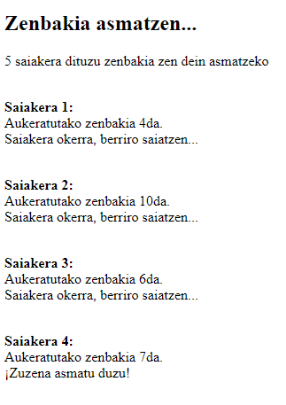
    
    - Adibidez horrelako zeozer  erakutsiko du programak:
