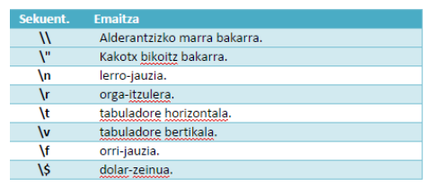

# DWS 2. unitatea - PHP Elementuak

## Testu kateak

PHPn testu kateak bi modutara adieraz ditzakegu:
- Kakotx sinpleak (`' '`) 
- Kakotx bikoitzak (`" "`)

Kateek kakotx sinpleak zein bikoitzak erabil ditzakete PHPn. Alde nabarmena dago bata eta bestearen artean, ordea: aldagaia kakotx bikoitzen artean jartzen dugunean, prozesatu egiten da eta beraren balioak ordezkatua da; hortaz, honela erabili genezake print:

```php
<?php
$ikasgaia="DWES";
print "<p>Ikasgaia: $ikasgaia</p>";
?>
```

`$ikasgaia` aldagaia kakotx bikoitzen artean da ezagutua, eta, irteera sortu baino lehen, “DWES”ekin ordezkatua da; hori berori kakotx sinpleak erabiliz egin izan bagenu, ez zen inolako ordezkapenik egingo.

### Aldagaiak kateetan

```php
<?php
$ikasgaia = "DWES";

// Kakotx bikoitzak: aldagaien ordezkapena egiten du
print "<p>Ikasgaia: $ikasgaia</p>";  // Irteera: Ikasgaia: DWES

// Kakotx sinpleak: testu literala bezala tratatzen du
print '<p>Ikasgaia: $ikasgaia</p>';  // Iriteera: Ikasgaia: $ikasgaia
?>
```

### Kateen kateatzea (concatenación)

```php
<?php
$izena = "Pertsona";
$agur = "Kaixo " . $izena . "!";
echo $agur;  // Irteera: Kaixo Pertsona!
?>
```

### Ihes egindako karaktereak

String kakotx bikoitzen artean badago ("), PHPk ihes-sekuentzia hauek interpretatuko ditu karaktere berezietarako:

Kakotx sinpleak erabiltzean, bi ordezkapen baino ez dira egiten katearen barruan: \' topatzen denean, kakotx sinplea erakusten da irteeran; \\ topatzen denean, berriz, alderantzizko marra erakusten da irteeran.
Sekuentzia horiek ihes-sekuentzia gisa ezagutuak dira. Kakotx bikoitzak erabiltzen dituzten kateetan, \\ sekuentziaz aparte, beste batzuk erabili daitezke; \' sekuentzia, ordea, ez. Kakotx bikoitzekin erabiltzeko ihes-sekuentziak agertzen dira honako taula honetan.



## String-erako aldatzea (Conversión a String)
### print funtzioaren erabilera

- `print` beste aukera bat da, eta antzera funtzionatzen du.
- `print` eta `echo`-ren arteko alderik handiena zera da: `print`-ek parametro bakarra jaso dezake eta bakarra bueltatzen du.
```php
int print (string $arg);
```

### print eta echo

```php
<?php
//lehenbizi, "echo" funtzioa probatuko dugu hainbat kate inprimatzeko

echo "Lehenengo katea", " bigarren katea", " hirugarren katea"; 

//komaz bereizitako zenbait kate inprima daitezke

//orain, print probatuko dugu. Ohartzerakoan, linea bakarra erabili dugu, baina print-arekin 3 kode-lerro behar dira, funtzio baten antzera funtzionatzen du eta parametro bakarra onartzen du

print "Lehenengo katea";
print " bigarren katea";
print " hirugarren katea";  ?>
```

### printf

`printf` irteera bat sortzeko beste aukera bat da. 

Hainbat parametro jaso ditzake:

- lehenengoa testu-katea da eta ezarri beharreko formatua adierazten du; 

- funtzioak beste hainbat parametro jaso ditzake, eta, horietako bakoitzagatik, bihurtze-espezifikadore bat eduki beharko du kateak -parametroak agertutako ordena berean-. 

Adibidez:
```php

<?php
$zikloa="DAW";
$ikasgaia="eDWS; print "<p>";
printf("%s %s zikloko %d mailako ikasgaia", $ikasgaia, $zikloa, 2);
print "</p>";
?>
```
Zelan uste duzue agertuko dela pantailan?


Espezifikadoreek `%` karakterea daukate aurretik, mota bakarrik da derrigorrezkoa, gainontzekoak hautazkoak dira.
Hurrengo estekan dituzu mota-espezifikadoreak:
<https://www.w3schools.com/php/func_string_printf.asp>


## Testu kateekin erlazionaturiko funtzioak

<https://www.php.net/manual/es/ref.strings.php>

### strlen () funtzioa

Katearen luzera itzultzen du.

```php
<?php
echo "Katearen luzera neurtu: ";
echo strlen("Katearen luzera neurtu");
?>
```

- Katearen luzera begiztetan (bucles) eta funtzioetan erabili ohi da; izan ere, horietan,
garrantzitsua baita katea noiz bukatzen den jakitea.
- Stringak array gisa tratatu ditzakegu; hala, katearen azken karakterea lortu nahiko
bagenu, honako agindu honekin egin genezake:
```php
$katea[strlen($katea)-1]
```

### strpos () funtzioa

Katearen barruan karaktere zehatza bilatzeko erabiltzen da; topatzen baldin badu,
topatutako lehenengo posizioa itzuliko du; behin ere topatzen ez badu, aldiz, `false`
itzuliko du. 

Zer erakutsiko luke honako kode honek?

```php
<?php
    $cadena="Esto es una cadena un poco más larga";
    $car='c';
    $palabra="poco";
    $pos=strpos($cadena,$car);
    echo "La posición de la 1ª '$car': ",$pos,"<br />";

    $pos=strrpos($cadena,$car);
    echo "La posición de la última '$car': ", $pos,"<br />";

    $pos=strpos($cadena,$palabra);
    echo "La posición de la palabra '$palabra': ", $pos,"<br />";
?>
```

!!! warning "KONTUZ!"
    Kontuan izan behar da, halaber, kate-en hasierako posizioak 0-n hasten direla, eta ez 1-en.
    
`strrpos()` funtzioak azkeneko aldia agertzen dena bilatzen du.

### substr() funtzioa

Katearen zati bat itzultzen du.

```php
string substr ( string $string , int $start [, int $length ] )
```

```php
<?php
    echo substr('abcdef', 1);     // bcdef
    echo substr('abcdef', 1, 3);  // bcd
    echo substr('abcdef', 0, 4);  // abcd
    echo substr('abcdef', 0, 8);  // abcdef
    echo substr('abcdef', -1, 1); // f    Zergatik ematen du emaitza hau?
?>
```

### substr() funtzioa

```php
<?php
    // Start negatiboa erabiliz
    $rest = substr("abcdef", -1);    // devuelve "f"
    $rest = substr("abcdef", -2);    // devuelve "ef"
    $rest = substr("abcdef", -3, 1); // devuelve "d"
?>
```

### strstr() funtzioa

Katearen barruan azpikatea topatzen du eta azpikatetik  -azpikatea bera barneaurrerako katea itzultzen du osorik.

```php
<?php
    $rest = strstr("abcdef", "c");    // devuelve "cdef"
?>
```

### strtr() funtzioa
Karaktereak bihurtzen ditu (edo substring-ak ordezkatu).

```php
string str_replace ( mixed $search , mixed $replace , mixed $subject [, int &$count ] )
```

Bilatutako string-aren agerraldi guztiak ordezkatze-string-arekin ordezkatzen ditu.

```php
<?php
    $rest = str_replace("c", "C", "abcdef");    // devuelve "Abcdef"
?>
```

### substr_count
Zenbat aldiz agertzen da substring bat string baten barruan. Letra larriz eta xehez sentikorra da

### substr_count() funtzioa
Substring-aren agerraldi-kopurua zenbatzen du.
### chr() funtzioa
Parametro gisa pasatutako ASCII-kode zenbakiari dagokion karakterea itzultzen du.
```php
echo chr(65);// ‘A’ katea itzuliko luke
```
### ord() funtzioa
Aurrekoaren kontrako funtizoa da. Parametro gisa pasatutako karaktereari dagokion
ASCII-kode zenbakia itzultzen du.
```php
echo ord(‘A’);// 65 zenbakia itzuliko luke
```

### explode()
Katea azpikatetan banatzen du.
```php
array explode (string separator, string string [, int limit])
```

### rtrim(), ltrim(), trim()
Eskumako, ezkerreko edo alde bietako zuriunak eta karaktere kontrolgarriak ezabatzen dituzte.

```php
// Adibide errealagoak:
echo rtrim("Hello World!   ");  // "Hello World!" (eskuineko zuriunak kentzen ditu)
echo ltrim("   Hello World!");  // "Hello World!" (ezkerreko zuriunak kentzen ditu)
echo trim("  Hello World!  ");  // "Hello World!" (bi aldeetako zuriunak kentzen ditu)
```

### strtolower() / strtoupper()
Katearen hizki guztiak xehe edo larri bihurtzen dituzte, hurrenez hurren.

```php
echo strtolower("Hello World!");  // "hello world!"
echo strtoupper("Hello World!");  // "HELLO WORLD!"
```
### strcmp() / strcasecmp()
Bi kate konparatzen dituzte. `strcmp()`-ek letra larriak eta xeheak bereizten ditu, `strcasecmp()`-ek ez.

```php
// strcmp() - Letra larri eta xeheak bereizten ditu
// Negatiboa: lehenengoa txikiagoa
// Zero: berdinak
// Positiboa: lehenengoa handiagoa

echo strcmp("Hello", "World");    // -1 (H < W alfabetoan)
echo strcmp("Hello", "Hello");   // 0 (berdinak)
echo strcmp("Hello", "hello");   // -32 ('H' ASCII 72 vs 'h' ASCII 104)
echo strcmp("Hello", "Hello!");  // -1 (bigarrena luzeagoa da)

// strcasecmp() - Ez du bereizten letra larri eta xeheen artean
echo strcasecmp("Hello", "HELLO");  // 0 (berdinak)
echo strcasecmp("Hello", "hello");  // 0 (berdinak)
echo strcasecmp("Hello", "Hello!");  // -1 (bigarrena luzeagoa da)
```


## Ariketa Praktikoa: Testu Prozesatzailea

!!! exercise "Ariketa: Testu Prozesatzailea"
    - [ ] Eginda dut
    
    Sortu PHP script bat `prozesatzailea.php` izenekoa, eta idatzi kodea honako funtzionalitateekin:
    
    1. Erabiltzaileak sartu behar du bere izen-abizenak (adibidez: "Juan Perez")
    2. Programa honek erakutsi behar ditu:
       - Izen-abizenak letra larriz
       - Izen-abizenak letra xehez
       - Izen-abizenaren luzera (karaktere kopurua)
       - Lehenengo karakterea eta azkena
       - Izena eta abizena bananduta (bietan lehenengo letra maiuskulaz)
       - Izen-abizenaren 3. eta 5. karaktereak
    
    **Adibidea:**
    ```
    Sarrera: "juan perez"
    
    Irteera:
    Izen-abizenak letra larriz: JUAN PEREZ
    Izen-abizenak letra xehez: juan perez
    Izen-abizenaren luzera: 10
    Lehenengo karakterea: 'j', Azken karakterea: 'z'
    Izena: Juan, Abizena: Perez
    3. karakterea: 'a', 5. karakterea: ' '
    ```

## HTML eta PHP konbinatuz

PHP eta HTML konbinatzea oso ohikoa da:

```php
<!DOCTYPE html>
<html>
<head>
    <title>PHP eta HTML</title>
</head>
<body>
    <h1>Ongi etorri, 
    <?php 
    $izena = "Pertsona"; 
    echo $izena; 
    ?>!</h1>
    
    <p>Noiz hasi zinen PHP ikasten? <?php echo date("Y-m-d"); ?></p>
</body>
</html>
```

## Ariketa: HTML eta PHP konbinatuz

!!! exercise "Ariketa 2"
    - [ ] Eginda dut
    
    Sortu HTML orri bat PHP kodea erabiliz:
    1. Sortu HTML5 dokumentu bat
    2. PHP erabiliz, erakutsi uneko urtea eta hileko eguna
    3. Erabili aldagai bat zure herrialdearen izenarentzat
    4. Erabili HereDoc formatua HTML kodea sortzeko
    
    **Aholkua:** Erabili `date()` funtzioa datak lortzeko

