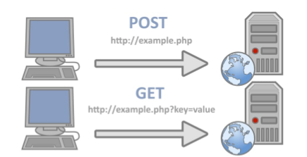
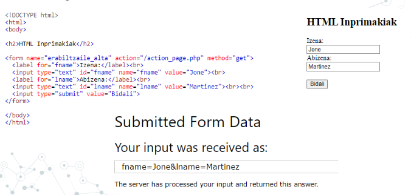
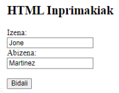
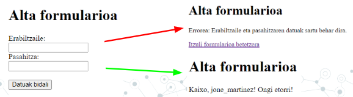
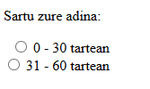
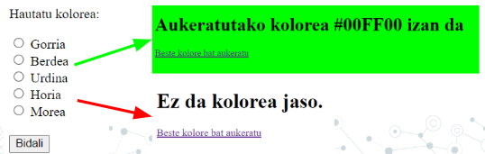
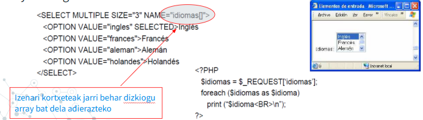
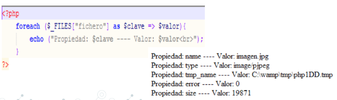

# 3. UNITATEA - FORMULARIOAK

## 3. Web programazioa PHPrekin

### Inprimakiak (Formularioak)
Inprimakiei esker ahal diegu erabiltzaileei informazioa eskatu eta beraiekin harremana izan.

Formulario HTML bat `<form>` eta `</form>` etiketen artean definitzen da.
```php
    <form action="/my-handling-form-page" method="get | post"></form>
```


Hurrengo elementuetatik jasotzen ditugu datuak:

```
INPUT 
    TEXT 
    RADIO 
    CHECKBOX 
    BUTTON 
    FILE 
    HIDDEN 
    PASSWORD 
    SUBMIT 

SELECT 
    SIMPLE 
    MULTIPLE 

TEXTAREA
```

## HTTP METODOAK - GET eta POST metodoak
Hauek biak badira HTTP protokoloaren metodoak, zerbitzaria eta bezeroaren arteko informazio-trukea egiteko.
Badaude bat baino gehiago, baina hauek biak dira ohikoenak:



### GET metodoa
Metodo horrek eskatzen dio web-zerbitzariari, bezeroari identifikatutako informazioa URL eskaeran itzultzeko. 

- GET metodoak URLan bidaltzen ditu aldagaiak. 
- URL bukaeran galdera (?) ikurria jarriko genuke eta jarraian aldagaia eta bere balioa. 
- Aldagai bat baino gehiago izanez gero `&` sinboloa erabiliko dugu.

```php
https://www.google.com/search?q=zer+da+php&rlz=1C1GCEB_enES1021ES1021&oq=zer+da+php&aqs=chrome..69i57j69i60l3.3326j0j15&sourceid=chrome&ie=UTF-8
```

### POST metodoa
POST metodoan informazioa kodeatuta dago HTTP eskaeraren gorputzean, eta, beraz, ezkutuan bidaiatzen du. Horregatik, metodo hau, erabiltzailearen informazioa formulario baten sartu nahi dugunean erabili beharko genuke.

```php
    https://moodle.fptxurdinaga.eus/my/ 

```

### GET vs POST konparaketa

| Ezaugarria | GET | POST |
|------------|-----|------|
| Parametroak | URIan daude | Gorputzean daude |
| Helburua | Dokumentuen berreskurapena | Datuen eguneraketa |
| Segurtasuna | Faborito bezela markatzeko aukera | Ezin da faborito moduan gorde |
| Datu motak | ASCII karaktereak bakarrik | Edozein datu mota (baita bitarrak ere) |
| Ikusgarritasuna | URLan ikusgai | Ezkutuan |
| Tamaina mugak | ~2000 karaktere | ~8MB |

### `$_REQUEST`
`$_REQUEST` array asoziatiboak `$_GET`, `$_POST` eta `$_COOKIE` arrayen edukia biltzen du. 

- Erabilera aurrekoen modukoa da, aldagai superglobala da ere.
- `$_REQUEST`, array asozitiboa $_GET, $_POST eta $_COOKIE arrayen edukiak dituena.
- Erabilera ohikoena izango da ez dakigunean zein metodoa erabili duen datuak bidaltzen dituen formularioak.
- Berez ez da datuak bidaltzeko metodo bat, ezin dugu formularioan method=REQUEST jarri. 


## FORM - Atributuak

Gogoratuko ditugu FORM elementuaren atributu garrantzitsuenak, batez ere guk informazio elkartrukea egitearakoan nahitaez erabiliko ditugunak:

- **Name**: Honetan formularioaren identifikazioa izango dugu, gogoratu orrialde bakar baten formulario bat baino gehiago izan ditzakegula.
- **Action**: Atributu honetan jarriko dugu gure datuak jasoko duen fitxategiaren url
- **Method**: get / post. Hauek dira izan ditzakeen balioak, beraz hemen adieraziko dugu zein den aukeratu dugun metodoa.

### Adibidea
Hurrengo adibidean, GET metodoa erabilida:


## Nola jasotzen ditugu datuak?

Gure formularioak bidaltzen duen informazioa jasotzeko, erabiliko dugu `$_POST[]` edo `$_GET[]` array asoziatiboak segun kasua zein den.

Aurreko adibidean, action_page.php scriptera deitzerakoan, `$_GET[]` arrayan sortu dira bi sarrera, fname eta lname identifikatzaileekin. Beraz, bi datu horiek jasotzeko, horrela egin genezakeen:

```php
// GET metodoa erabiliz
$izena = $_GET["fname"];
$abizena = $_GET["lname"];

// POST metodoa erabiliz
$izena = $_POST["fname"];
$abizena = $_POST["lname"];
```

Badago aukera ere `$_REQUEST` arraya erabiltzeko, batzutan intesgarria izan daitekeelako ez jakitea zein metodo erabili duen formularioak. Baina gomendioa izango da ahal den heinean `$_POST[]` edo `$_GET[]` erabiltzea.

Hauek guztiak dira PHPrekin aldagai globalak. Gogoratu,  PHPko aldagai super globalak edonondik eskura daitezke eta informazio espezifikoa gordetzen dute horietan, kasu hauetan formularioan bidalitako datu guztiak.

!!! exercise "Ariketa UD3 - 1"
    - [ ] Eginda dut

    Sortu `ariketa1.php` formulario bategaz. Formulario horrek deituko du `ariketa1_jaso.php` fitxategiari, eta honek datuak jasoko ditu eta ongi etorria emango dio pertsona horreri.
    Gutxi gora behera itxura hau izan beharko du:

    


## `isset()` eta `empty()` funtzioak

### `isset()`

Funtzio honek esango digu ia aldagaia definitu den ala ez, baiezko kasuan true bueltatuko du.

Oso funtzio erabilgarria da jakiteko ia formulario bateko daturen bat bidali den ala ez. Ez du konprobatzen balio bat duen ala ez, naiz eta hutsik egon, true emango bait du


```php
    if (isset($_GET['izena'])) {
        $izena = $_GET['izena'];
    } else {
        $izena = 'Gonbidatua';
    }
```

!!! warning " `isset()` - Modu modernoan"
    Gaur egun `isset()` erabiltzerakoan, ez da horrela egiten, hori modu klasikoa da.

    ```php
        $izena = $_GET['izena'] ?? 'Gonbidatua';
    ```
    
    Operadorea isset() + baldintzapeko esleipena egiten duen gauza bera egiten du, baina modu dotoreagoan. 
    
    Ezkerreko aldea ebaluatzen du, eta nulua bada edo ez badago, eskuineko aldearen balioa itzultzen du.


### `empty()`
Funtzio honekin jakin dezakegu aldagai batek balioa duen ala ez. 

Aldagai bat dago hutsik ez baldin bada existitzen edo bere balioa false baldin bada.

```php
    
    if (!empty($adina)) {
        $mezua = $adina . ' urte dituzu';
    } else {
        $mezua = 'Adina ez da zehaztu';
    }

```

!!! warning " `empty()` - Modu modernoan"
    empty-ren kasuan pixkatxo bat ezberdina da, oraindik ez dago operadore zuzenik.

    ```php
        $mezua = !empty($adina) ? $adina . ' urte dituzu' : 'Adina ez da zehaztu';
    ```

#### Zelan erabiliko genituzke biak elkarrekin?
Programatzerakoan, oso ohikoa da biak elkarrekin erabili behar izatea, kasu horretan horrela egingo genuke:

**Modu klasikoan**

```php
   if (isset($_POST['helbidea']) && !empty($_POST['helbidea'])) {
        $helbidea = $_POST['helbidea'];
    } else {
        $helbidea = 'Helbidea ez da zehaztu';
    }
```

**Modu modernoan**

```php
    $helbidea = ($_POST['helbidea'] ?? '') ?: 'Helbidea ez da zehaztu';

    // Goiko hau da izango zen honen modukoa: 
    // $helbidea = (isset($_POST['helbidea']) && !empty($_POST['helbidea'])) ? $_POST['helbidea'] : 'Helbidea ez da zehaztu';

```


!!! warning "Laburpena"

    | Egoerak: | Klasikoa | Modernoa |
    |------------|----------|----------|
    | `isset()` | `isset($var) ? $var : $default` | `$var ?? $default` |
    | `empty()` | `!empty($var) ? $var : $default` | Ez dago operadorerik |
    | Biak | `isset($var) && !empty($var) ? $var : $default` | `($var ?? '') ?: $default` |

!!! exercise "Ariketa UD3 - 2"
    - [ ] Eginda dut
    
    Sortu formulario bat, izena, abizena eta emaila jasotzen dituena, baina kasu honetan POST metodoa erabili. 

    Formulario honen deia `ariketa2_post.php` fitxategiari izango da.

    Datuak jasotzerakoan, konprobatuko dugu datuak jaso ditugun ala ez.

    Datuak izatekotan, erakutsi datuak pantailan, bestela daturen bat falta dela idatzi.

    (isset() eta empty() funtzioak erabili hori konprobatzeko)


!!! exercise "Ariketa UD3 - 3"
    - [ ] Eginda dut
    
    Alta formulario bat sortu, erabiltzailea eta pasahitza eskatzen dituen formularioa, POST metodoarekin. 
    
    Fitxategi bakar baten egin behar da, beraz, lehenengo aldian formularioa erakutsi, baina datuak bidali izatekotan, konprobatu datu biak sartu dituen ala ez.

    Biak sartu ezkero Ongi Etorria emango diogu, bestela datu biak behar ditugula esango diogu:

    **Adibidea:**
    


## Inprimakien elementuak

Aurreko adibideetan ikusi dugu zelan jasotzen diren INPUT text baten balioak, gainontzeko kasuetan antzeko izango da, ala ere hainbat adibide ikusiko ditugu.

### INPUT TYPE="radio"

```php
* Horrela idatzi beharko genuke formularioan:

    <form action="/action_page.php">
        <p>Sartu zure adina:</p>
        <input type="radio" id="age1" name="age" value="30">
        <label for="age1">0 - 30 tartean</label><br>
        <input type="radio" id="age2" name="age" value="60">
        <label for="age2">31 - 60 tartean</label><br>
    </form>

* Horrela jasoko genuke elementu horren balioa gure php-an:

	$adina = $_GET[“age”];
	echo $adina;    // aukeratu duen aukeraren “value” hartuko du, gogoratu value hori ez dela pantailan erakusten

```




!!! exercise "Ariketa UD3 - 4"
    - [ ] Eginda dut
    
    Sortu bi fitxero, bat ariketa4.php eta bigarrena ariketa4_kolore.php. Lehenengo fitxategiak izan behar du formulario bat radiobutton bategaz 5 koloreen artean bat aukeratzeko. Koloreak hexadecimalean egon behar dute.

    ariketa4_kolore.php fitxategiak, kolorea jasoko du eta fondoaren kolorea, jasotako kolorea izango du.

    **Adibidea:**
    


### INPUT TYPE="checkbox"

Checkbox-en kasuan, elementu bat baino gehiago aukeratu daitekeenez, datu hori jasotzean, array baten egingo dugu, beraz izenean ere kortxeteak jarriko ditugu, array bat dela adierazteko.

```php
* Horrela idatzi beharko genuke formularioan:

    <input type="checkbox" name="vehicle[]" value="Bike">
    <label for="vehicle1"> Bizikletaz</label><br>
    <input type="checkbox" name="vehicle[]" value="Car">
    <label for="vehicle2"> Kotxez</label><br>

* Horrela jasoko genuke elementu horren balioa gure php-an:

    $vehicles = $_GET["vehicle"];
    foreach($vehicles as $vehicle) {
        echo "<p>".$vehicle ."</p>";
    }

```
!!! exercise "Ariketa UD3 - 5"
    - [ ] Eginda dut

    Sortu formulario bat checkboxes-ekin hainbat aukera aukeratzeko. Aukeratutako elementuak zerrenda moduan erakutsi.

    <a href="https://docs.google.com/document/d/1t3WAMh68Iv2FfxlaQl6YdBf0p4Qybe7f/edit?usp=sharing&ouid=102374284777397967809&rtpof=true&sd=true target="_blank">Ariketa 5</a>

### SELECT

Kasu honetan, select arrunta bada, gaionontzeko elementuekin moduan jasoko dugu, balioa value propietatean duena da

Baina select multiple elementua izatekotan, hau da, balio bat baino gehiago hartu dezakenean, array baten gordeko ditu balioak.



### INPUT TYPE="file"

Mota honetako datuak bidaltzeko, beti `POST` metodoaren bidez egin behar da, eta jasotzeko, badago aldagai globala `$_FILES` izenekoa. 

Kontutan izan behar dugu ia "php.ini" fitxategian, `file_uploads = on` dagoen jarrita, horrek fitxeroan bidali daitezkela adierazten du 

Formularioak ere hurrengo atributu hau behar du `enctype="multipart/form-data"`, esateko zein edukiera mota erabili formularioa bidaltzeko.

Fitxategia array asoziatibo baten gordeko da, lehenengo klabea fitxategiaren izena izango da eta bigarrena fitxategi horren datuak.
`$_FILES["fileToUpload"]["tmp_name"]`

```php
        [fitxategi_izena] => Array
        (
            [name] => MyFile.jpg
            [type] => image/jpeg
            [tmp_name] => /tmp/php/php6hst32  //PHPk ematen dio behin behineko izen bat zerbitzariaren diskan gorde arte
            [error] => UPLOAD_ERR_OK   // Adierazten du ia errore baten bat egon den kargatzerako orduan
            [size] => 98174   // Fitxategiaren pisua bytesen adierazita
        )
```


```php
    * Horrela idatzi beharko genuke formularioan:

     <form method="POST" enctype="multipart/form-data">
         <input type="file" name="fitxategia">
     </form>


    * Horrela jasoko genuke elementu horren balioa gure php-an:

    $fitxategia = $_FILES['fitxategia'];
    $izena = $fitxategia['name'];
    $tmp_izena = $fitxategia['tmp_name'];

    if (move_uploaded_file($tmp_izena, "img/" . $izena)) {
        echo "Fitxategia ondo igo da";
    } else {
        echo "Errorea fitxategia igotzean";
    }
```
#### Zelan egin dezakegu hau seguruago izateko?

Aurreko adibidea ondo dago, baina ez da guztiz segurua, hainbat arazo ditu eta horiek direla eta Path injection-a gertatzea posiblea da.

1. Hasierako izena erabiltzen da ⚠️

    ``` php
        $izena = $fitxategia['name'];  // ARRISKUTSUA!
    ```
Arazoa: Erabiltzaileak ../../index.php bezalako izenak jar ditzake

2. Ez dira erroreak egiaztatzen ⚠️

    ```php
        // Ez duzu begiratzen $_FILES['fitxategia']['error'] errorea
    ```

3. Ez dira fitxategi motak mugatzen ⚠️

    ```php
        // .php, .exe, .js fitxategiak ere onar ditzake!
    ```

4. Ez da tamaina mugatzen ⚠️

Modu seguruago baten programatzeko, HTML kodea ere aldatu beharko genuke, hasieratik hainbat gauza mugatzeko:

```php

// Horrela sortuko genuke formularioa
   <form method="POST" enctype="multipart/form-data">
        <input type="file" name="fitxategia" accept=".jpg,.jpeg,.png,.gif,.pdf">
        <input type="submit" value="Igo fitxategia">
    </form>

// Eta hau izango litzateke fitxategia jasotzeko kodea
    // 1. Fitxategia igo den egiaztatu
    if (!isset($_FILES['fitxategia']) || $_FILES['fitxategia']['error'] !== UPLOAD_ERR_OK) {
        echo "Errorea: Ez da fitxategirik igo";
    }

    $fitxategia = $_FILES['fitxategia'];

    // 2. Fitxategi mota baimentzeko
    $baimentutako_motak = ['jpg', 'jpeg', 'png', 'gif', 'pdf'];
    $fitxategi_luzapena = strtolower(pathinfo($fitxategia['name'], PATHINFO_EXTENSION));

    if (!in_array($fitxategi_luzapena, $baimentutako_motak)) {
        echo "Errorea: Fitxategi mota ez da baimendua";
    }

    // 3. Tamaina mugatu (5MB) - Gogoratu size bytetan adierazita egoten dela, MB-era pasatuko dugu konparaketa egiteko
    if ($fitxategia['size'] > 5 * 1024 * 1024) {
        echo "Errorea: Fitxategia handiegia da";
    }

    // 4. Izen segurua sortu (hasierako izena ez erabili!) - Hau adibide bat  (uniqid('fitx_') Izen bakarra sortzen du prefixo batekin:))
    $izen_segurua = uniqid('fitx_') . '.' . $fitxategi_luzapena;
    $helburu_osoa = "img/" . $izen_segurua;

    // 5. Direktorioa existitzen den egiaztatu
    if (!is_dir('img/')) {
        mkdir('img/', 0755, true);
    }

    // 6. Fitxategia mugitu
    if (move_uploaded_file($fitxategia['tmp_name'], $helburu_osoa)) {
        echo "Fitxategia ondo igo da: " . $izen_segurua;
    } else {
        echo "Errorea fitxategia igotzean";
    }


```

!!! exercise "Ariketa UD3 - 6"
    - [ ] Eginda dut
    
    Sortu formulario bat fitxero bat igotzeko. 
    
    Jasotzerakoan fitxategia, konprobatu `$_FILES` aldagaiak jasotzen dituen datu guztiak eta pantailan inprimatu.

    **Adibidea:**
    

!!! exercise "Ariketa UD3 - 7"
    - [ ] Eginda dut
    
    Aurreko ariketan oinarrituta, konprobatu fitxategiak 1MB baino gehiago pisatzen duen. 

    Gehiago pisatuz gero "Errorea: Fitxategia handiegia da" mezua erakutsi, bestela "Fitxategia ondo igo da".


!!! exercise "Ariketa UD3 - 8"
    - [ ] Eginda dut

    Sortu formulario bat ikasleen datu bilketarako (`ariketa8.php`). Izena, abizena, adina eta irudi bat. 

    Irudia "img" karpetan sartu behar dugu. Fitxategi berak datuak jasoko ditu eta erakutsiko ditu. Gogoratu irudia ere erakutsi behar duela.

    Modu seguru baten egiten saiatu.

    **Adibidea:**
    