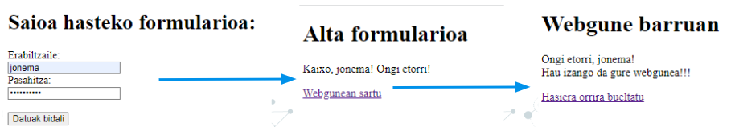

# Saioak (Sesiones)

Funtsean, saio bat da erabiltzaileak webgune batean bisitatzen dituen orrien sekuentzia. Gure lekuan sartzen denetik lekua uzten duen arte.

PHPko saio terminoa nabigazio-sekuentzia honi aplikatzen zaio; horretarako, nabigazio-saio bakoitzari esleitzen diogun identifikadore bakarra sortuko dugu.


## Zer dira saioak?

Saio bat erabiltzaile baten informazioa gordetzeko mekanismo bat da, hainbat orrialdetan zehar mantentzen dena. PHP-k saioak automatikoki kudeatzen ditu cookie baten bidez.

Beharrezko datuak gordetzeko zerbitzari-fitxategi batzuk erabiltzen dira, izena sses_ eta jarraian saioaren identifikazio-zenbakia edo session id izanez. 

Id saioa ausaz sortzen da erabiltzaileak gunera egiten duen konexio bakoitzerako. 
Balio hori lehenetsitako sistemaren konstante batean gordetzen da, hau da, PHPSESSID.

Saioaren aldagaiak eskuragarri daude php $_SESSION [] elkartze-matrizearen bidez, indize gisa berreskuratu nahi dugun aldagaiaren izena jasotzen duela.


## Saioak hasi

PHPko saioak erabiltzeko, lehenengo gauza horiek abiaraztea da.

!!! Warning "`session_start()`"
    Edozein datu gorde baino lehen, sesioen erabilera hasi behar dugu, hau da, `<html>` edozein kode idatzi baino lehen egin behar da.

```php
    <?php
        // Saioa hasi
        session_start();

        // Aldagai bat gorde saioan
        $_SESSION['erabiltzailea'] = 'ikaslea';
        $_SESSION['rola'] = 'admin';
    ?>
```

## Saioaren datuak erabili

`session_start()` hasi egiten du zerbitzari eta bezeroaren arteko saioa, eta momentu horretatik aurrera usten digu `$_SESSION` barruan dauden aldagaiak erabili.

Hurrengo fitxategi baten, berriro deitu behar dugu session_start() funtzioari eta saioan gordetako aldagaiak erabili ahal izateko. Ez badugu funtzio honi deitzen, ezingo ditugu gordetako aldagaiak erabili.

```php
    <?php
    // Saioa hasi (beharrezkoa da orrialde bakoitzean)
    session_start();

    // Datu bat erakutsi
    if(isset($_SESSION['erabiltzailea'])) {
        echo 'Ongi etorri, ' . htmlspecialchars($_SESSION['erabiltzailea']);
    }
    ?>
```

Saioa edozein unetan lor dezakegu session_id () funtzioaren bidez. Sartu hurrengo lerroa, saioa eskuragarri dagoen ikusteko:

```php
    $saioa = session_id ();
    echo "Saioa: " . $saioa;
```

## Saioa itxi
Saio bat erabiltzen dugunean, gogoratu beharko genuke hori ezabatzen ere.

Saio baten balioa ezabatzako `unset()` erabitzen da, saioa baten balio guztiak desbinkulatzeko `session_unset();` eta saioa guztiz ezabatzeko `session_destroy();`

`unset` egiten dugunean, datu guztiak ezabatzen ditu, baina saioa erabiltzen jarraitu dezakegu. `Destroy` egiterakoan aldiz, ez.

```php
    <?php
        session_start();

        // 1. Aldagai bakarra ezabatu
        unset($_SESSION['erabiltzailea']);

        // 2. Saio datu guztiak garbitu (baina saioa mantendu)
        session_unset();
        // EDO
        $_SESSION = [];

        // 3. Saioa guztiz ezabatu
        session_destroy();

        // 4. Cookie ere ezabatu (oso segurua izan nahi badugu) Horrela bezeroan ere ezabatuko genuke
        if (isset($_COOKIE[session_name()])) {
            setcookie(session_name(), '', time() - 3600, '/');
        }
    ?>
```

## Saioa Konfiguratu

### Iraupena aldatu:

```php
    <?php
        // Saioa 30 minutu iraun dezan
        ini_set('session.gc_maxlifetime', 1800);
        session_set_cookie_params(1800);
        session_start();
    ?>
```

### Session regenerate (segurtasunarentzat):

```php
    <?php
        session_start();

        // Login egin ondoren, saio ID berria sortu
        if ($login_egoki) {
            // Session ID berria sortu segurtasunarentzat
            session_regenerate_id(true);
        }
    ?>
```

## Segurtasuna

- Beti erabili `session_start()` saioarekin lan egin aurretik
- **Erabili `htmlspecialchars()`** erabiltzailearen sarrera bistaratzean, XSS ekiditeko.  
- **Egiaztatu erabiltzailearen baimenak** orrialde babestuetan sartzerakoan.  
- JavaScript-etik cookie-a ez atzitu
    ```php
        ini_set('session.cookie_httponly', 1);
    ```

- SameSite babesteko
    ```php
        ini_set('session.cookie_samesite', 'Strict');
    ```

- Informazio gehiago: <a href="https://www.php.net/manual/en/session.security.ini.php" target="_blank">Securing Session INI Settings</a>


!!! exercise "Ariketa UD3 - 9"
    - [ ] Eginda dut

    Ariketa txiki bat sortuko dugu saioekin lan egiteko. Horretarako eskatuko ditugu gure webgunera sartzeko datuak: erabiltzailea eta pasahitza.
    
    Behin sartuta, beste orri batera pasatuko gara, hemen datuak saio aldagai baten sartuko ditugu, honetan esteka bat jarriko dugu hirugarren orri batera pasatzeko, eta hirugarren honetan, datuak saiotik atera eta ongi etorria egingo dugu.
    Ariketan segurtasun puntu hauek gehituko ditugu:

    1. Saioaren iraupena:
        - Saioak gehienez 2 minutuko inaktibitatea onartuko du.
    2. Session fixation ekiditea:
        - Login arrakastatsuaren ondoren, saioaren ID berrituko dugu.
    3. Session fixation ekiditea:
        - Login arrakastatsuaren ondoren, saioaren ID berrituko dugu.
    4. Logout segurua:
        - session_destroy() egiteaz gain, cookie-a ere ezabatu behar da.

    